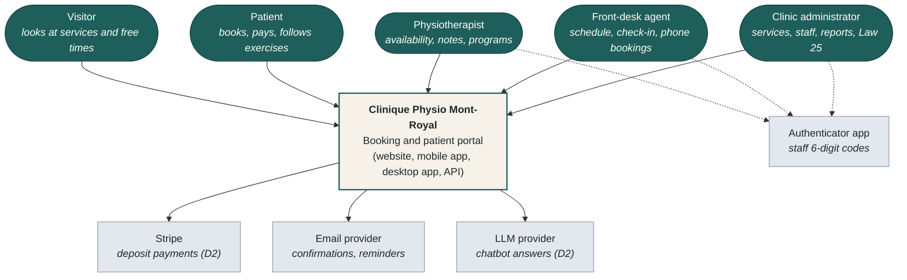
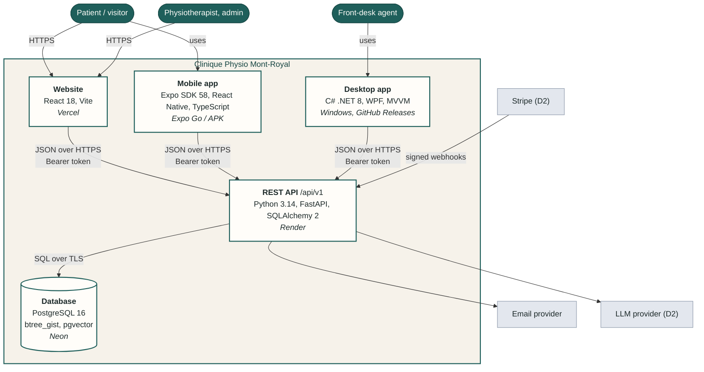
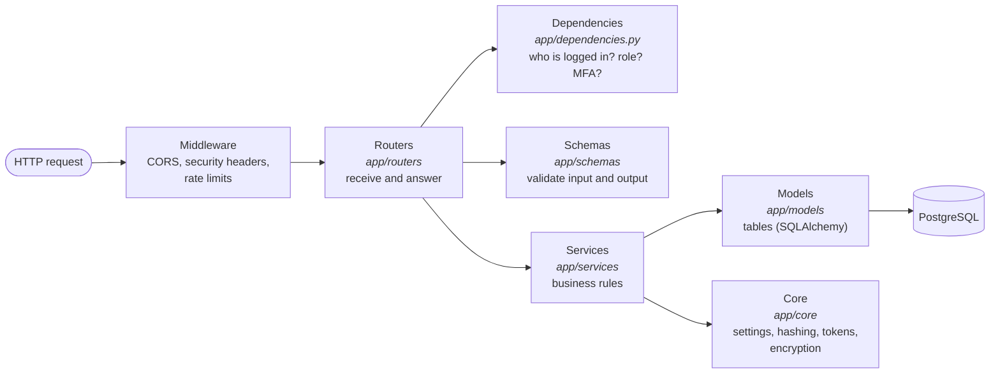
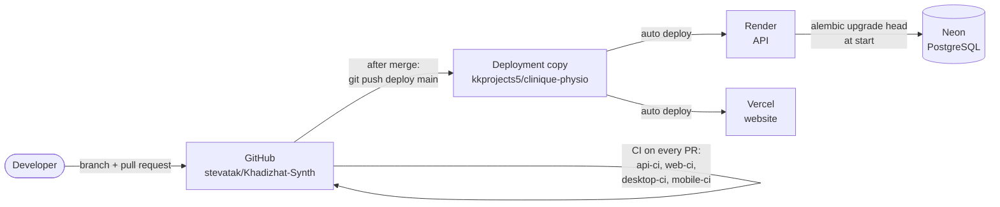

# Architecture — Clinique Physio Mont-Royal

Status: **D1 (v0.1.0)**. Diagrams follow the [C4 model](https://c4model.com) (levels 1 and 2,
plus a short level 3 for the API). Design decisions are recorded as ADRs in [adr/](adr/).

Related documents: [requirements.md](requirements.md), [erd.md](erd.md) (data model),
[data-dictionary.md](data-dictionary.md), [openapi.json](openapi.json) (API contract),
[threat-model.md](threat-model.md), [data-classification.md](data-classification.md).

## 1. System context (C4 level 1)

Who uses the system, and which outside systems it depends on.

## 2. Containers (C4 level 2)

The separately deployed parts, their technology, and how they talk to each other.

| Container | Responsibility | Technology | Hosting |
|---|---|---|---|
| Website | Public pages, booking, patient portal, therapist workspace, admin | React 18, Vite, React Router, TanStack Query, i18next | Vercel (static files, CSP headers) |
| Mobile app | Patient: appointments, exercises, reminders | Expo SDK 58, React Native, TypeScript, SecureStore | Expo Go (dev), APK (release) |
| Desktop app | Front desk: day schedule, check-in, phone bookings, offline mode (D3) | C# .NET 8, WPF, CommunityToolkit.Mvvm | Windows install from GitHub Releases |
| REST API | **All** business rules and permission checks; the only door to the data | FastAPI, Pydantic, SQLAlchemy 2, Alembic, Argon2id, PyJWT, pyotp, slowapi | Render (free plan) |
| Database | Relational data, constraints (no double booking), embeddings for the chatbot (D2) | PostgreSQL 16 with `btree_gist` and `pgvector` | Neon; Docker locally |

**Key rule:** the three clients are never trusted. They only display data and send requests; the
API checks every request (who is calling, with which role, and whether they own the data).

## 3. Inside the API (C4 level 3, simplified)

Each request goes through the same layers. Business logic never lives in the routers (NFR-11).

| Layer | Folder | Example |
|---|---|---|
| Routers | `app/routers` | `auth.py` receives a login and returns tokens |
| Dependencies | `app/dependencies.py` | `require_staff` refuses tokens without MFA |
| Schemas | `app/schemas` | `RegisterRequest` refuses weak passwords |
| Services | `app/services` | `slots.py` computes free slots; `session_service.py` rotates refresh tokens |
| Models | `app/models` | `Appointment` with the no-overlap constraint |
| Core | `app/core` | `security.py` (Argon2id, JWT), `crypto.py` (field encryption) |

## 4. API routes

The full contract, with request and response schemas, is generated by FastAPI:
[openapi.json](openapi.json), live at https://clinique-physio-api.onrender.com/docs.

### Implemented (D1)

| Method and route | Purpose | Access |
|---|---|---|
| `POST /auth/register` | Create a patient account (consents recorded) | Public, rate-limited |
| `POST /auth/verify-email` | Confirm the email address | Public, rate-limited |
| `POST /auth/login` | Log in: tokens (patients) or MFA ticket (staff) | Public, rate-limited |
| `POST /auth/mfa/setup` | First staff login: create the authenticator secret | MFA ticket |
| `POST /auth/mfa/verify` | Check the 6-digit code, open the staff session | MFA ticket |
| `POST /auth/refresh` | New tokens from the refresh cookie (rotation) | Refresh cookie |
| `POST /auth/logout` | Revoke the refresh token | Refresh cookie |
| `POST /auth/password/forgot` | Send a password reset link (same answer for every email) | Public, rate-limited |
| `POST /auth/password/reset` | Set a new password with the link; cancels all sessions | Public, rate-limited |
| `GET /me` | The logged-in user | Any logged-in user |
| `GET /me/appointments` | Own upcoming appointments | Patient (own only) |
| `GET /staff/session` | Check a staff session (with MFA) | Staff with MFA |
| `GET /services`, `GET /therapists` | Catalog and team | Public |
| `GET /availability` | Free slots for a service | Public |
| `GET`, `PUT /therapist/availability` | Own weekly hours | Therapist with MFA |
| `POST`, `DELETE /therapist/availability/exceptions` | Own time off | Therapist with MFA (owner only) |
| `GET /desk/schedule?date=` | All therapists' appointments for a day | Front desk or admin with MFA |
| `GET /health` | Health check for the host | Public |

### Planned (from spec B.7)

| Method and route | Purpose | Access | Deliverable |
|---|---|---|---|
| `POST /appointments/hold`, `POST /appointments/{id}/pay` | Hold a slot 10 minutes, pay the deposit | Patient | D2 |
| `POST /webhooks/stripe` | Payment confirmation (signed, idempotent) | Stripe | D2 |
| `POST /appointments/{id}/reschedule`, `POST /appointments/{id}/cancel` | Change or cancel (24 h rule) | Patient (owner) | D2 |
| `GET /therapist/schedule`, `GET /therapist/patients/{id}` | Own schedule; patient file | Therapist (care relationship) | D2 |
| `POST /therapist/appointments/{id}/notes`, `GET /therapist/notes/{id}` | Clinical notes (encrypted, audited) | Therapist (author / care relationship) | D2 |
| `POST /therapist/patients/{id}/programs`, `GET /me/program`, `POST /me/program/logs` | Exercise programs and check-off | Therapist; patient (own) | D2 |
| `POST /desk/appointments`, `POST /desk/appointments/{id}/check-in` | Phone booking, check-in | Front desk | D2 |
| `POST /chat/messages`, `POST /chat/feedback` | Chatbot | Public, rate-limited | D2 |
| `GET /me/receipts/{id}.pdf` | Insurance receipt | Patient (own) | D3 |
| `POST /desk/sync` | Offline actions from the desktop | Front desk | D3 |
| `/admin/*` (services, staff, audit, privacy requests, incidents, reports) | Administration and Law 25 | Admin | D3 |

## 5. Deployment and delivery

- The API applies database migrations automatically when it starts.
- Secrets (database URL, signing key, encryption key) are set in the Render dashboard, never in
  the repository. See [ADR-006](adr/0006-deployment-copy.md) for why a deployment copy is used.
- The desktop app is published as a release on GitHub (D3); the mobile app as an APK or Expo link.

## 6. Cross-cutting concerns

| Concern | How it is handled |
|---|---|
| Security | See [threat-model.md](threat-model.md). Authentication: [ADR-002](adr/0002-token-storage.md). |
| Concurrency | Database exclusion constraint: [ADR-001](adr/0001-double-booking-exclusion-constraint.md). |
| Time zones | UTC storage, Montréal display: [ADR-004](adr/0004-time-zones.md). |
| Languages | French by default, English available; texts in translation files in each client (NFR-10). |
| Accessibility | Labels, keyboard navigation, contrast, skip link on the website (ESLint `jsx-a11y`); 48 px touch targets on mobile (NFR-09). |
| Testing | Automated tests in every app, run by CI on every pull request; API tests on their own database. |
