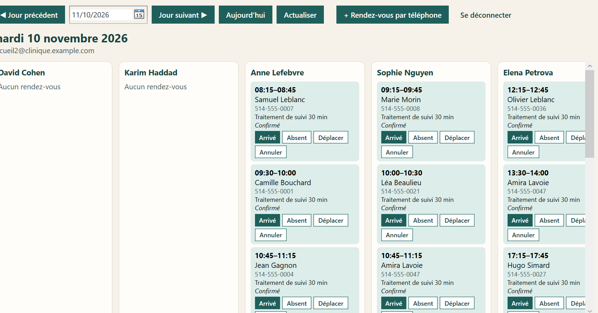
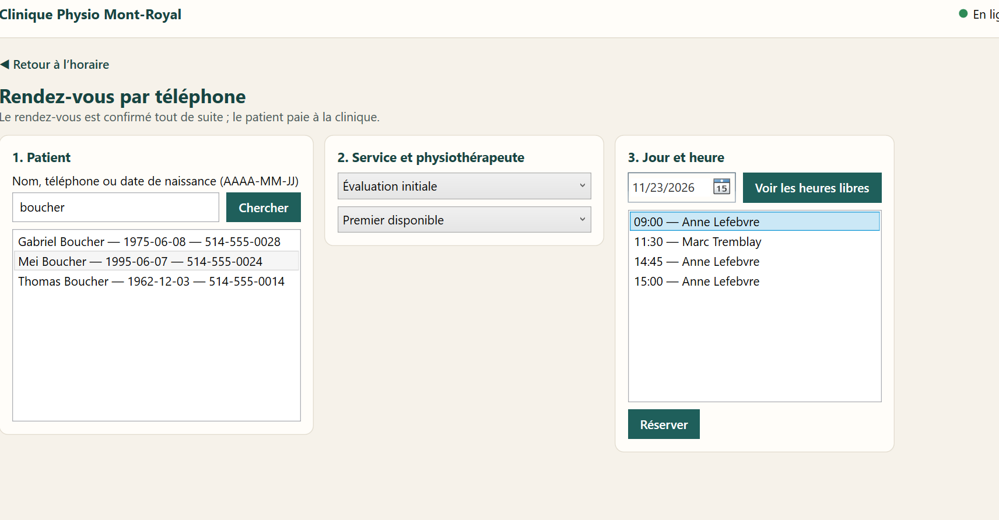
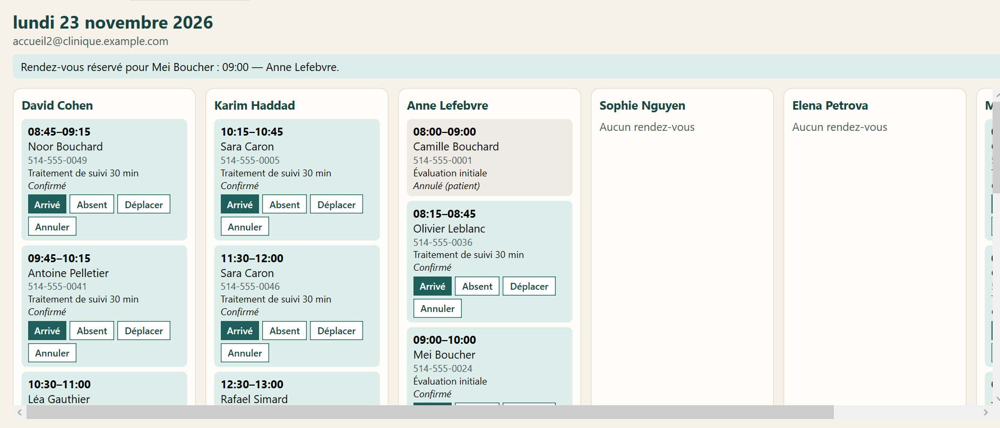
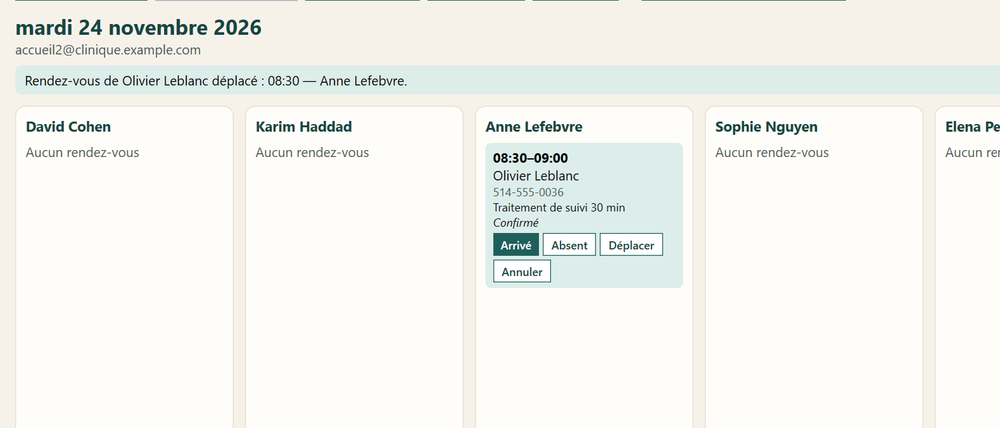
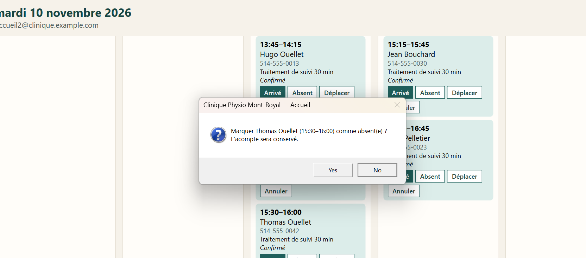
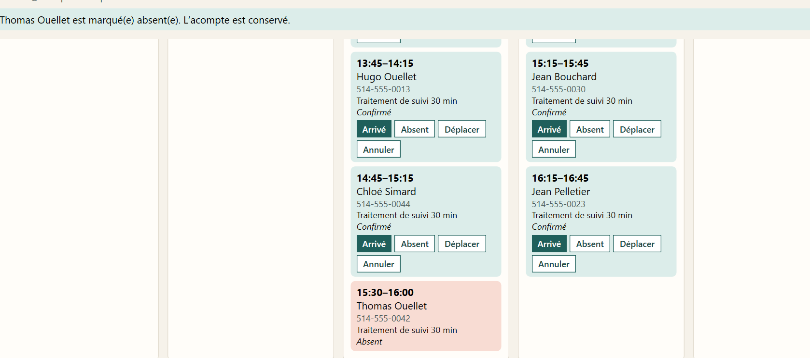
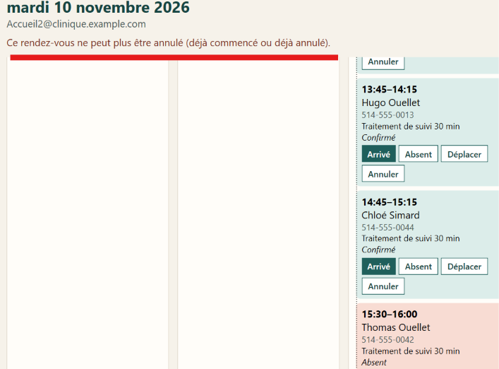
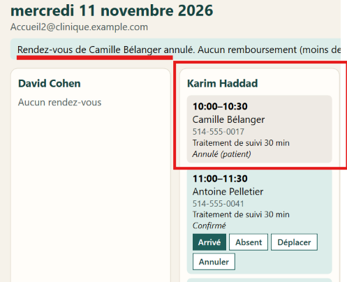

# D2 demo: front desk on the desktop app (phone booking, check-in, no-show)

Screenshots of the desktop app (WPF) on the live API, 2026-11-10, logged in as a front-desk
agent with MFA. All data is fictional.

| # | Screenshot | What it shows | Requirement |
|---|---|---|---|
| 1 |  | The day schedule, one column per therapist. Each **confirmed** appointment has the desk actions: **Arrivé** (check-in), **Absent** (no-show), **Déplacer** (move), **Annuler** (cancel). | B-FRD-01, 02, 03 |
| 2 |  | "Rendez-vous par téléphone": search "boucher" finds three patients, told apart by date of birth and phone; service, **Premier disponible** (first available), day, then the free times in Montréal time. | B-FRD-02 |
| 3 |  | After **Réserver**: back on that day's schedule with the message "Rendez-vous réservé pour Mei Boucher : 09:00 — Anne Lefebvre". The appointment is **confirmed** at once (paid at the clinic). | B-FRD-02 |
| 4 |  | **Déplacer**: Olivier Leblanc's appointment moved to another day and time; the schedule opens on the new day. | B-FRD-02, B-BKG-06 |
| 5 |  | **Absent** asks for confirmation first, because it cannot be undone and the deposit is kept. | B-FRD-03, B-BKG-04 |
| 6 |  | The appointment becomes **Absent** (red), with the message "L'acompte est conservé". Possible only 15 minutes after the start. | B-FRD-03 |
| 7 |  | The server refuses to cancel an appointment that has already started (or is already cancelled); the app explains why in plain words. | B-BKG-06 |
| 8 |  | **Annuler** for a patient who calls: the appointment shows "Annulé (patient)" and the message says whether the deposit is refunded (here less than 24 hours before: no refund). | B-FRD-02, B-BKG-06 |

## Rules shown (all checked again by the API, never only by the app)

- A phone booking takes the same free times as the website; if the time was just taken, the API
  answers 409 and the app shows the free times again (no double booking, ADR-001).
- Check-in only on the day of a confirmed appointment; no-show only 15 minutes after its start.
- Cancellation more than 24 hours before refunds the online deposit through Stripe; otherwise the
  deposit is kept. A cancellation asked by the patient on the phone is recorded as
  "cancelled by patient", with the front-desk agent as the actor in the status history.
- The front desk sees names, phones and services only, never clinical notes (B-CLN-05).

## How to reproduce

1. `cd desktop` then `dotnet run --project src/CliniquePhysio.Desktop`; log in with the front-desk
   account and the 6-digit code.
2. **+ Rendez-vous par téléphone**: search a name, phone or date of birth (AAAA-MM-JJ), choose a
   service and a day, **Voir les heures libres**, choose a time, **Réserver**.
3. On the schedule, use **Arrivé**, **Absent**, **Déplacer** or **Annuler** on a confirmed appointment.
