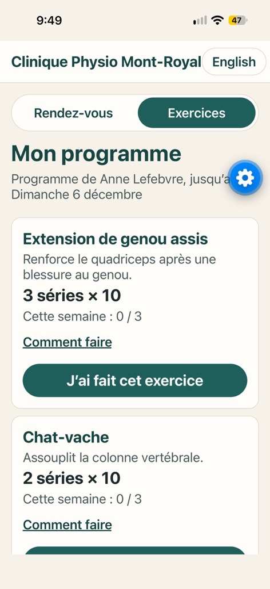
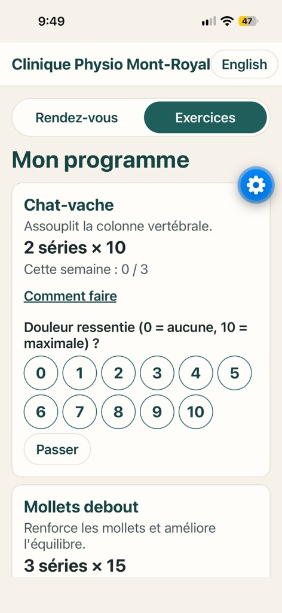
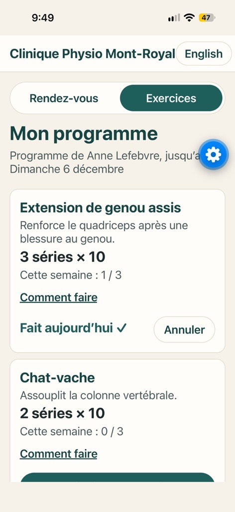
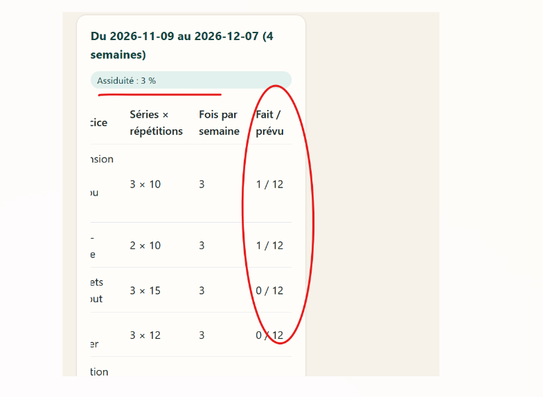

# D2 demo: home exercises on the mobile app

Screenshots of the patient app (Expo Go on an iPhone, live API) on 2026-11-09, logged in as the
fictional patient Mei Boucher (`patient24@example.com`). The program was given by her
physiotherapist in the website workspace ([d2-therapist-workspace](../d2-therapist-workspace/README.md)).

| # | Screenshot | What it shows | Requirement |
|---|---|---|---|
| 1 |  | **Exercices** tab: the program in progress (from Anne Lefebvre, until Sunday 6 December), each exercise with what it is for, sets × repetitions, sessions done this week (0 / 3), "Comment faire" for the instructions, and the button **J’ai fait cet exercice**. | B-EXE-03 |
| 2 |  | After tapping the button: **pain felt from 0 to 10** (11 round buttons, 48 dp, easy to tap) or **Passer** to skip. | B-EXE-03, NFR-09 (accessibility) |
| 3 |  | Checked off: **Fait aujourd’hui ✓** and this week **1 / 3**. **Annuler** undoes a mistake, only on the same day. Each exercise counts at most once a day (database rule). The therapist sees the adherence and pain level in the workspace. | B-EXE-03, B-EXE-04 |
| 4 |  | Back on the website, the **therapist** sees the result: two exercises at **1 / 12** and **Assiduité : 3 %** (2 sessions done out of 60 planned: 5 exercises × 3 per week × 4 weeks). The patient's phone and the therapist's workspace use the same API and the same rules. | B-EXE-04 |

The blue gear button is Expo Go's developer menu; it is not part of the app.

## How to reproduce

1. A therapist gives a program to a patient in the website workspace.
2. `cd mobile`, then `npx expo start --tunnel` (logged in to Expo), and scan the QR code with the phone.
3. Log in as that patient (phone 514-555-00NN means `patientNN@example.com`), open **Exercices**,
   tap **J’ai fait cet exercice**, choose a pain level.
4. On the website, as the therapist, reload the patient's file: the program shows **Fait / prévu**
   1 / 12 and a higher **Assiduité** (screenshot 4).
