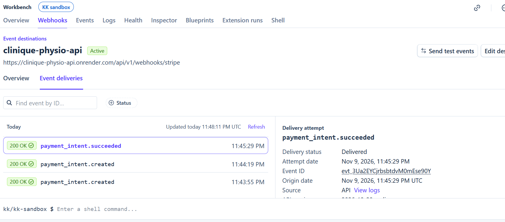
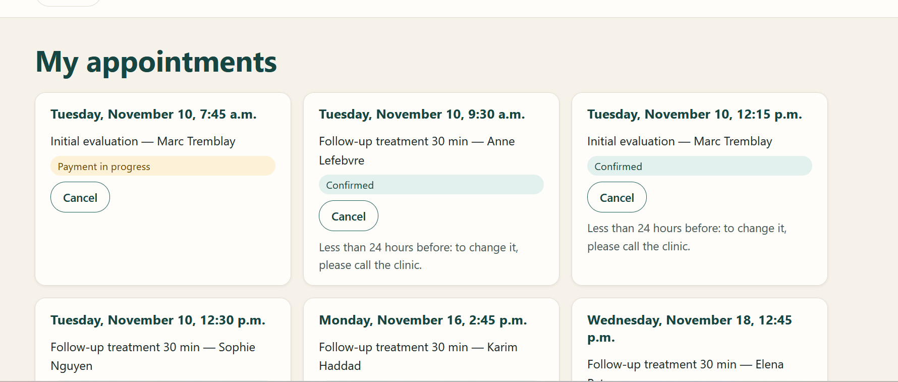
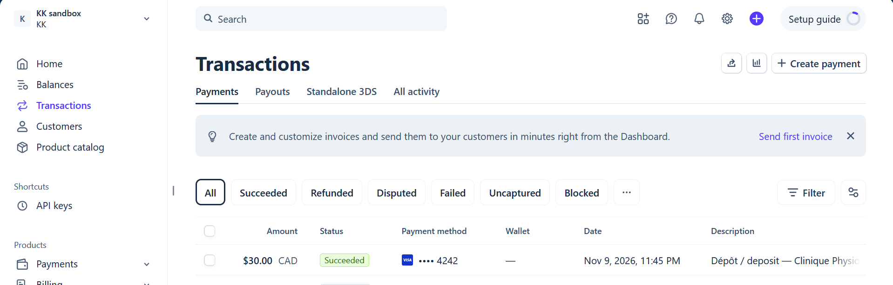
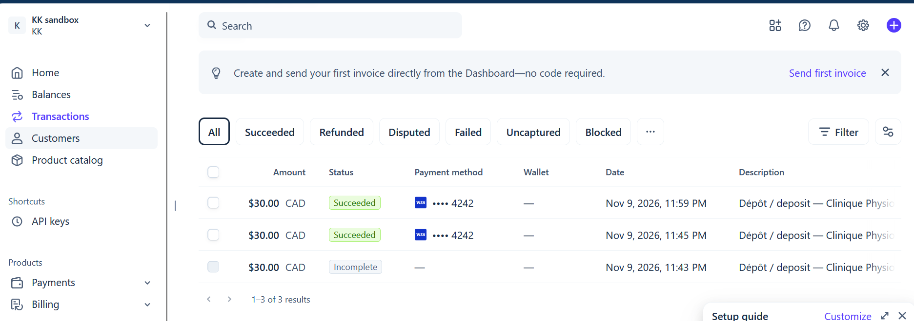
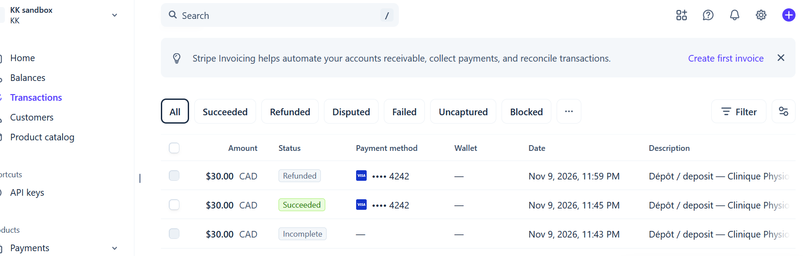

# D2 demo: online booking with Stripe deposit (test mode)

Screenshots of the live system on 2026-11-09 (Stripe Sandbox, test card 4242; no real money).
All data is fictional.

| # | Screenshot | What it shows | Requirement |
|---|---|---|---|
| 1 |  | Stripe's webhook `payment_intent.succeeded` delivered to the live API and accepted (**200 OK**) after the signature check. This is what confirms the appointment, never the browser (ADR-007). | B-BKG-04 |
| 2 |  | The patient's "My appointments" page: paid appointments are **Confirmed**; an unfinished payment shows **Payment in progress** until its 10-minute hold expires; less than 24 hours before, the page says to call the clinic to change it. | B-BKG-01, 03, 06 |
| 3 |  | Stripe's dashboard: the 30,00 $ CAD deposit **Succeeded** (card 4242). The card number never reached our API. | B-BKG-04 |
| 4 |  | A second booking paid; the **Incomplete** line is a payment that was started and abandoned (its hold expired by itself). | B-BKG-03, 04 |
| 5 |  | After cancelling more than 24 hours before, the deposit is **Refunded** through Stripe automatically. | B-BKG-06 |

## How to reproduce

1. Website, Disponibilités: choose a service and click **Réserver** on a time at least 2 days ahead.
2. Log in as a demo patient, then **Réserver et payer le dépôt**; card 4242 4242 4242 4242, any
   future date, any CVC. The page shows "Rendez-vous confirmé" after a few seconds.
3. Stripe (Sandbox), Webhooks, the endpoint, Event deliveries: `payment_intent.succeeded` 200 OK.
4. My appointments, **Annuler**, **Oui, annuler**: "Votre dépôt sera remboursé"; in Stripe the
   payment shows **Refunded**.
