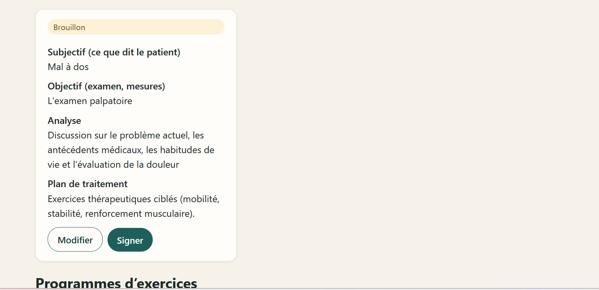
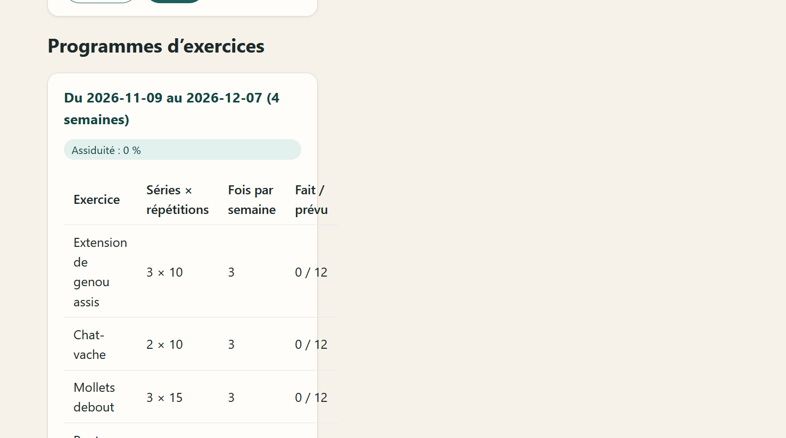

# D2 demo: therapist workspace on the website

Screenshots of the live website on 2026-11-09, logged in as a demo physiotherapist (password
plus 6-digit code). All patients and notes are fictional.

| # | Screenshot | What it shows | Requirement |
|---|---|---|---|
| 1 |  | A SOAP note (Subjective, Objective, Assessment, Plan) written after a visit, saved as a **draft**. Only its author can **edit** or **sign** it; once signed it can never change, and a correction becomes a signed amendment. The note is encrypted in the database and every opening of the file is in the audit log. | B-CLN-02, B-CLN-03, B-CLN-04 |
| 2 |  | A 4-week home program given to the patient from the clinic's exercise library: sets × repetitions, times per week, and **adherence** (sessions done / planned), which grows as the patient checks off exercises on the mobile app. | B-EXE-02, B-EXE-04 |

## How to reproduce

1. Run `python -m app.seed --refresh-appointments` once (adds completed visits of the last 10 days).
2. Website, **Connexion**, a therapist account; first time, scan the QR code with an
   authenticator app, then type the 6-digit code.
3. **Espace thérapeute**, a patient, **Rédiger la note** on a past visit; save the draft, then
   **Signer**, then **Ajouter un amendement**.
4. **Nouveau programme**: tick exercises, set times per week, **Donner le programme**.
