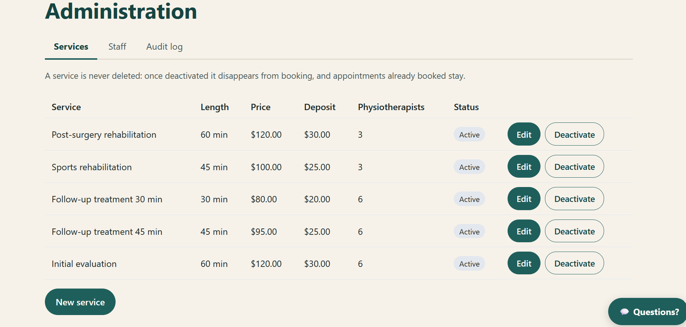
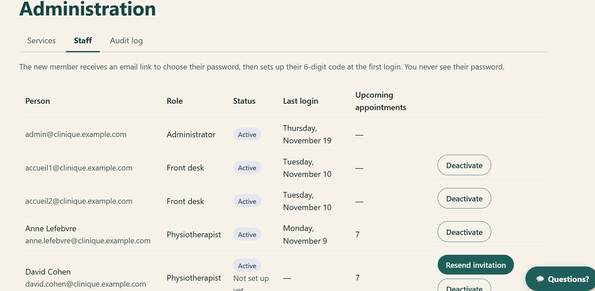
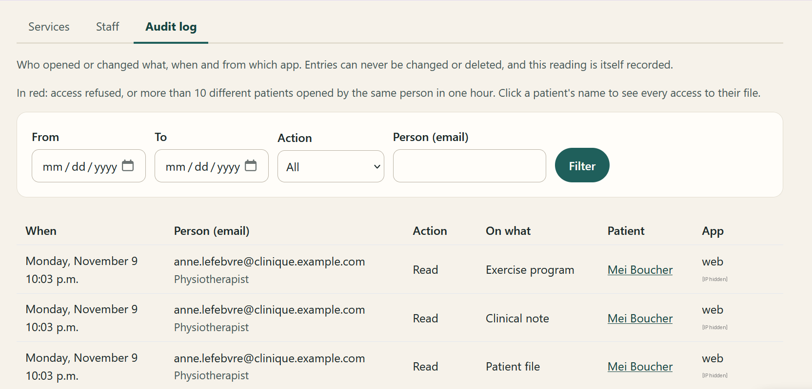

# D3 demo: administration (services, staff, audit log)

Screenshots of the live website on 2026-11-19, logged in as the administrator with MFA.
All data is fictional. The IP address in the audit log is hidden in the screenshot.

| # | Screenshot | What it shows | Requirement |
|---|---|---|---|
| 1 |  | The services with length, price, online deposit and the number of physiotherapists who give each one. **Edit** changes names, prices and therapists; **Deactivate** removes a service from booking without deleting it (past appointments keep pointing to it). | B-ADM-01 |
| 2 |  | Staff accounts with role, status, last login and upcoming appointments. "Not set up yet": the person has not chosen a password or set up the 6-digit code; **Resend invitation** sends a new one-time link. **Deactivate** closes the account's sessions at once; for a therapist the app first warns about upcoming appointments. There is no button for the administrator account. | B-ADM-01 |
| 3 |  | Who opened or changed what, when and from which app: here a physiotherapist reading a patient's file, clinical notes and exercise program. Filters by date, action and person; clicking a patient's name shows every access to that file. Refused accesses, and more than 10 different patients opened by one person in an hour, appear in red. | B-ADM-03, B-CLN-04 |

## Rules shown (all checked by the API, never only by the page)

- Only an administrator with a two-factor session can use these pages.
- The administrator never sees or chooses another person's password: new staff receive a link
  valid 72 hours, then set up their 6-digit code at the first login.
- No administrator account can be created or deactivated through the application.
- Audit entries can never be changed or deleted (database trigger), and reading the log is
  itself recorded.

## How to reproduce

1. Log in on the website as the administrator (password and 6-digit code).
2. Open **Administration** in the menu and use the three tabs.
