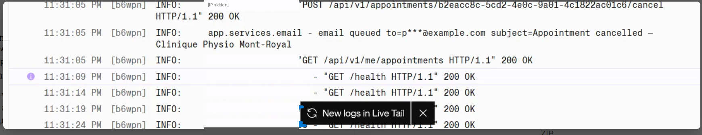

# D3 demo: booking emails

Screenshot of the live API log (Render) on 2026-11-19, right after a demo patient cancelled
an appointment on the website. IP addresses are hidden in the screenshot.

- The patient receives an email when an appointment is confirmed (after Stripe's payment, or at
  once for a phone booking), moved or cancelled, in their own language (here English).
- The log shows only that the email left, with a masked address (`p***@example.com`) and the
  subject: never the body, because some emails (password reset) contain secret links.
- The email has only practical information: date and time in Montréal time, service,
  physiotherapist, address, and the 24-hour rule or what happens to the deposit. Never
  clinical information (BR-8).
- No email provider is connected yet, so emails are not delivered in production (accepted
  risk R-9 in the threat model); in development they are printed in the API console.
- Proved by `api/tests/test_notifications.py`.
