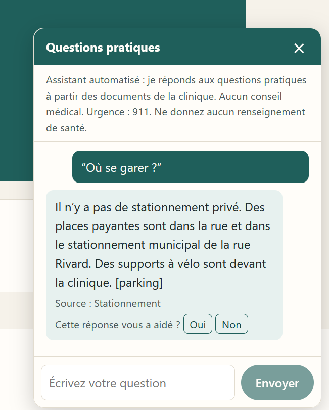
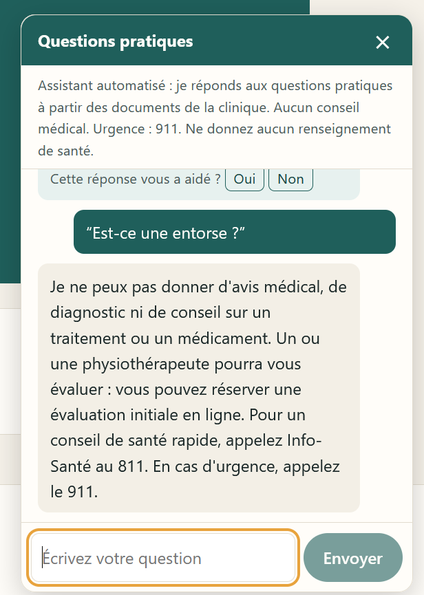
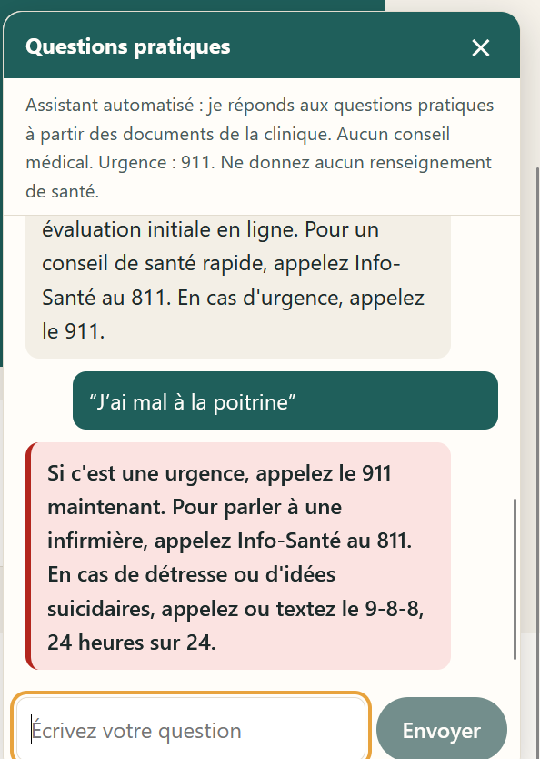
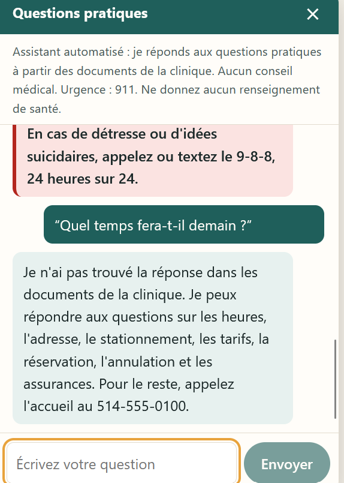
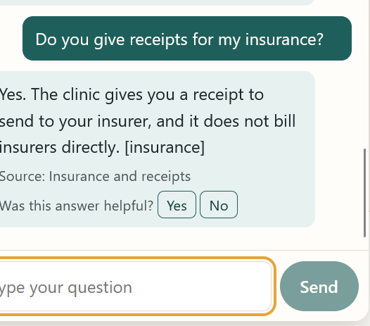

# D3 demo: chatbot for practical questions

Screenshots of the live website on 2026-11-18, with OpenAI switched on (ADR-0008). All data is
fictional. The chat opens with the **Questions ?** button at the bottom right of every page.

| # | Screenshot | What it shows | Requirement |
|---|---|---|---|
| 1 |  | "Où se garer ?": the answer comes from the clinic's parking passage, with its source under it and the 👍/👎 feedback buttons. The notice at the top says it is an automated assistant that gives no medical advice. | B-BOT-01, 02, 05 |
| 2 |  | "Est-ce une entorse ?": a diagnosis request is refused with a fixed text (book an evaluation, Info-Santé 811, 911). It never reaches OpenAI. | B-BOT-02 |
| 3 |  | "J'ai mal à la poitrine": only 911, Info-Santé 811 and the 9-8-8 crisis line, highlighted in red. No other content. | B-BOT-02 |
| 4 |  | "Quel temps fera-t-il demain ?": the answer is not in the clinic's documents, so the bot says so and gives the front desk's number instead of guessing. | B-BOT-01 |
| 5 |  | In English, OpenAI rewrites the insurance passage into a natural answer. It is accepted only because it cites that passage and passes the safety rules again. | B-BOT-01, 03 |

In screenshots 1 and 5, the source marker at the end of the sentence (`[parking]`,
`[insurance]`) was removed from the text in the next version: the source stays shown under
the answer.

## Measured quality

- Keyword mode (CI, no AI): [chatbot-evaluation.md](../../chatbot-evaluation.md), 40/40.
- OpenAI mode: [chatbot-evaluation-ai.md](../../chatbot-evaluation-ai.md), 40/40.

## How to reproduce

1. Open the website, click **Questions ?**.
2. Ask the questions above; switch to **English** at the top for an English answer.
