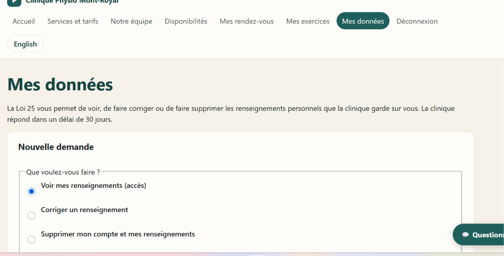
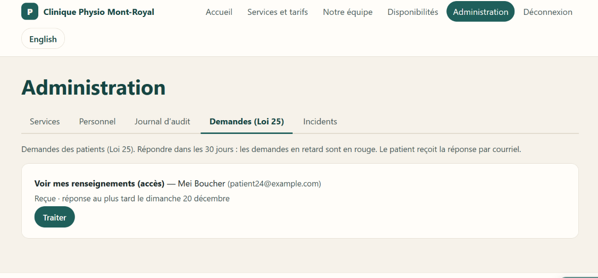
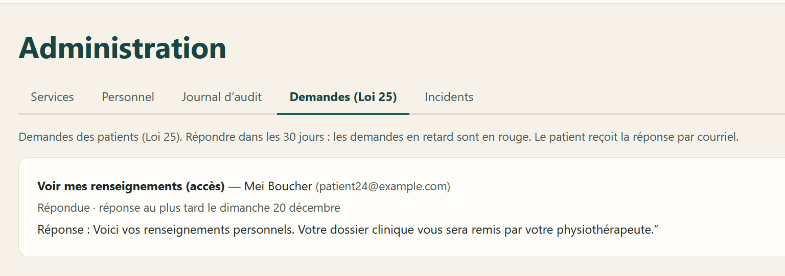
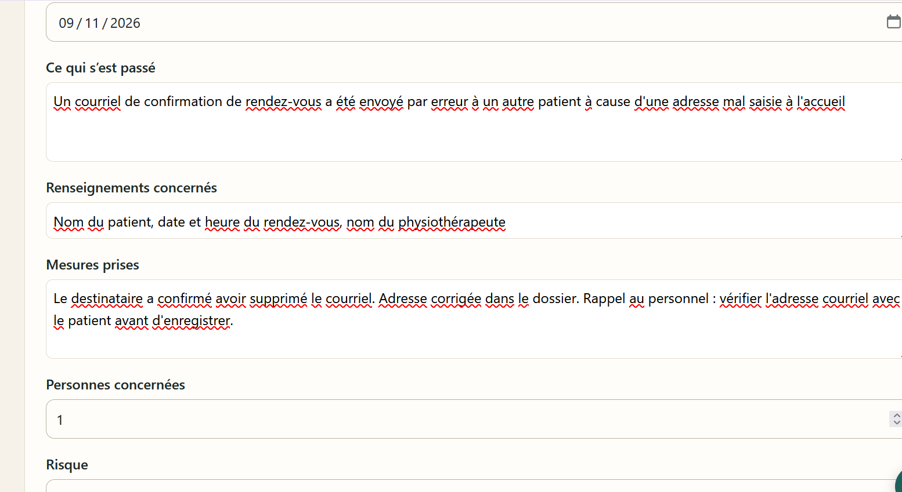
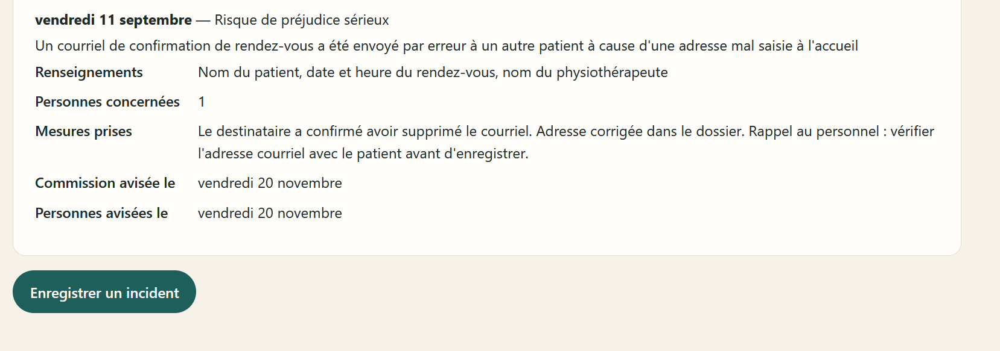
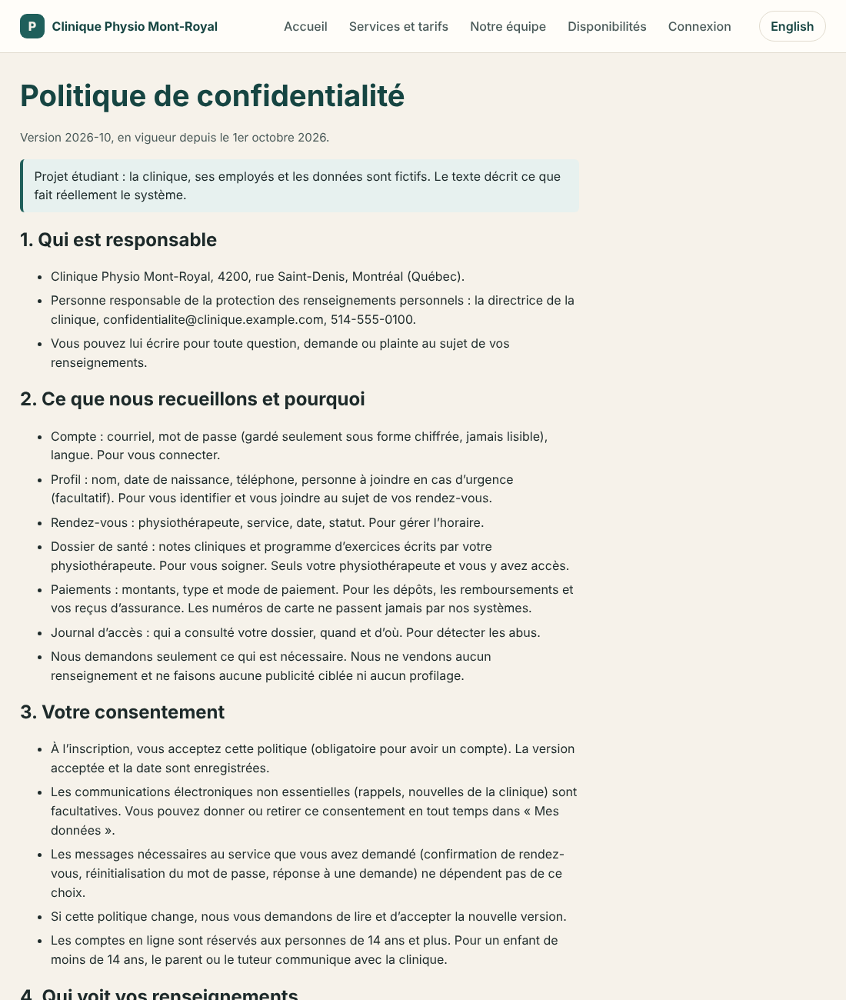
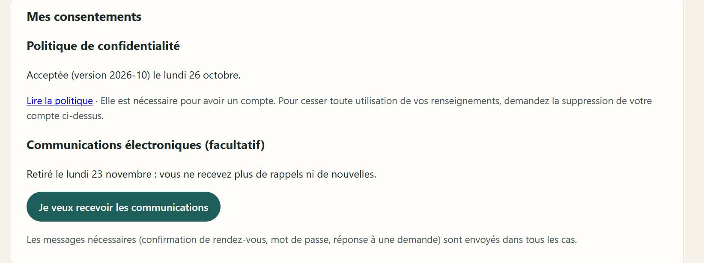
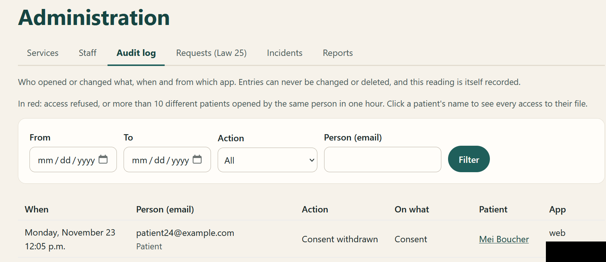

# D3 demo: Law 25 (privacy requests, incident register, policy and consents)

Screenshots of the live website on 2026-11-20. All data is fictional.

| # | Screenshot | What it shows | Requirement |
|---|---|---|---|
| 1 |  | The patient's **Mes données** page: ask to see, correct or delete the personal information the clinic keeps. The clinic answers within 30 days. One open request of each type at a time. | B-ADM-04 |
| 2 |  | The administrator's **Demandes (Loi 25)** tab: the request, the patient and the deadline (30 days). Late requests appear in red. **Traiter** opens the request. | B-ADM-04 |
| 3 |  | After the export (personal information without clinical notes) and the written answer: the request is **Répondue**, and the patient gets the answer by email and on the Mes données page. | B-ADM-04 |
| 4 |  | Recording a confidentiality incident: what happened, the information involved, the measures taken, the number of people concerned and the risk level. | B-ADM-05 |
| 5 |  | A serious-risk incident in the register, after the administrator recorded that the Commission d'accès à l'information and the person concerned were notified. Entries are kept at least 5 years and cannot be deleted (database trigger). | B-ADM-05 |
| 6 |  | The public **Politique de confidentialité** (French and English), linked in the footer of every page and in the consent box at registration: person in charge, data collected and why, consent, hosting outside Québec, retention, rights, complaint to the CAI, cookies. Screenshots 6 to 8: 2026-11-23. | Law 25 art. 3.2, 8 |
| 7 |  | **Mes données → Mes consentements**: the policy version accepted and its date; the optional consent to electronic messages, withdrawn by the patient (date shown) and given back with one click. | Law 25 art. 8.3, 14 |
| 8 |  | The administrator's **Journal d'audit**: the withdrawal is recorded with the patient and the app. IP address hidden in this screenshot. | B-ADM-03 |

## Rules shown (all checked by the API, never only by the page)

- Only the patient can ask for their own data; only the administrator (two-factor session) handles requests and incidents.
- An answer must be written before a request is closed, and the patient is told by email.
- The export for an access request never contains clinical notes; the export is recorded in the audit log.
- A deletion deactivates the account at once. The health record is kept as the law requires (5 years after the last visit), and the answer says until when.
- Incident entries can be completed (notification dates) but never deleted.

## How to reproduce

1. Log in on the website as a patient, open **Mes données** and send a request.
2. Log in as the administrator, open **Administration → Demandes (Loi 25)**, click **Traiter**, prepare the export, write the answer and click **Répondre (terminée)**.
3. In **Incidents**, record an incident with the risk set to "Risque de préjudice sérieux", then record the notifications.
4. Open the footer link **Politique de confidentialité**; as a patient, open **Mes données → Mes consentements** and withdraw then give the optional consent; as the administrator, filter the **Journal d'audit** on **Consentement retiré**.
