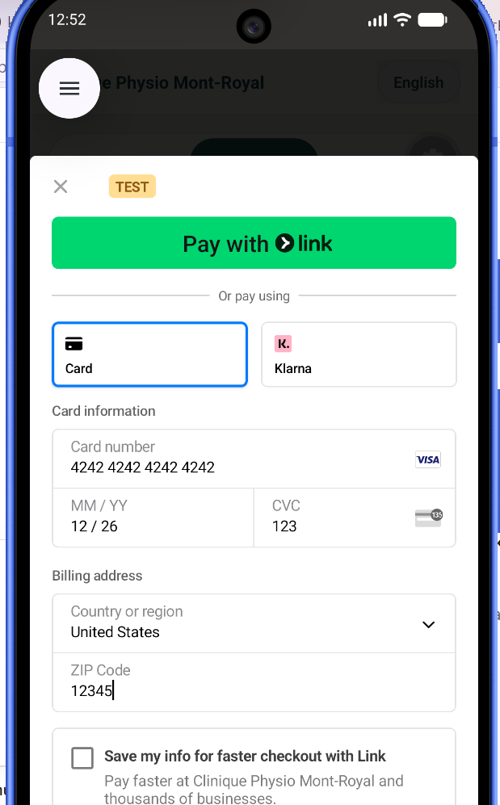
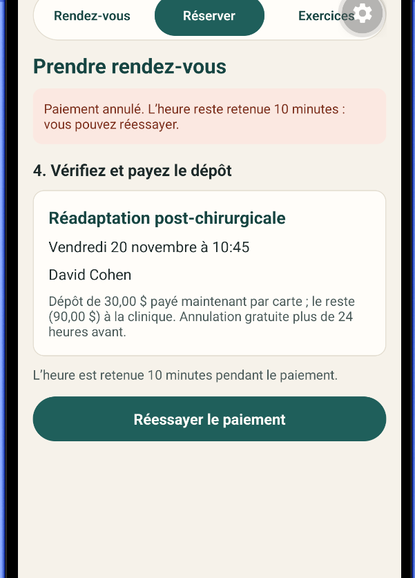
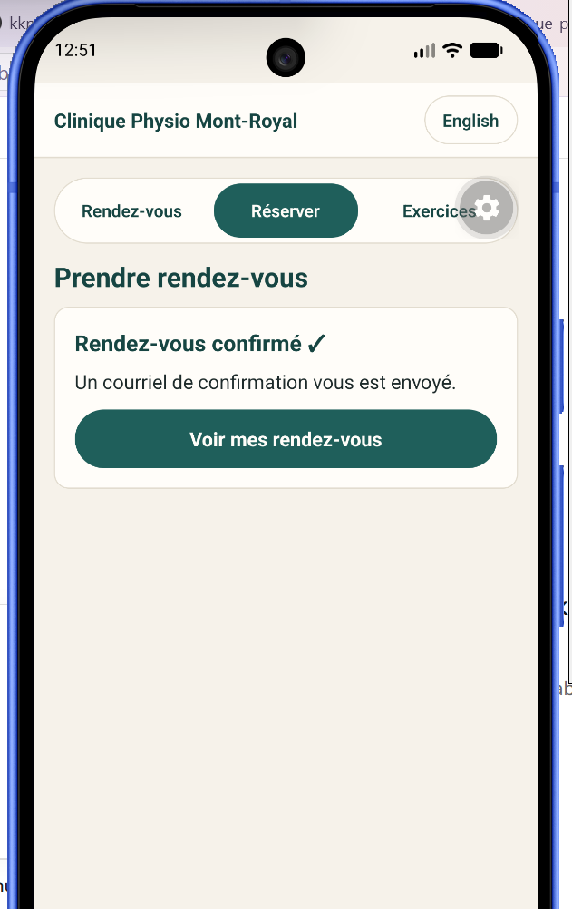

# D3 demo: booking from the mobile app

Screenshots of the Expo app on a phone (Expo Go) against the live API on 2026-11-20, logged in
as a demo patient. Stripe is in **test mode**: the card is Stripe's test card, no real money.

| # | Screenshot | What it shows | Requirement |
|---|---|---|---|
| 1 |  | After choosing a service, a physiotherapist (or first available), a day and a time, Stripe's own payment sheet opens on the phone (marked TEST). Card details go straight to Stripe, never to the clinic's API. | B-BKG-01, B-BKG-04 |
| 2 |  | The patient closed the sheet: the time stays held for 10 minutes and **Réessayer le paiement** reopens it for the same appointment (same Stripe payment, no second hold). The summary shows the service, the time in Montréal time, the physiotherapist, the deposit and the rest paid at the clinic. | B-BKG-03 |
| 3 |  | After paying, the app waits until the API has received Stripe's signed confirmation (webhook), then shows the appointment as confirmed; the confirmation email is sent. | B-BKG-01, B-BKG-04 |

## Rules shown (checked by the API)

- The appointment is confirmed only by Stripe's signed webhook, never by the app itself.
- A held time is released after 10 minutes if the deposit is not paid; a time taken in the
  meantime is refused with a clear message and the list of times is shown again.
- Free cancellation more than 24 hours before (deposit refunded through Stripe).

## How to reproduce

1. In `mobile`, start Expo (`npx expo start --tunnel`) and open the app in Expo Go.
2. Log in as a demo patient, open **Réserver**, choose a service, a physiotherapist and a time.
3. Pay with the test card 4242 4242 4242 4242, any future date and any CVC.
