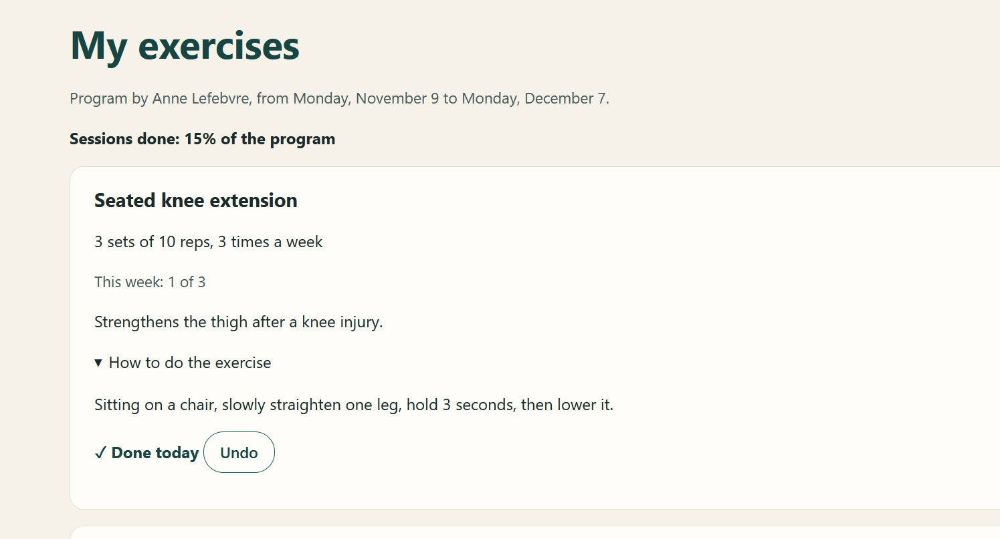
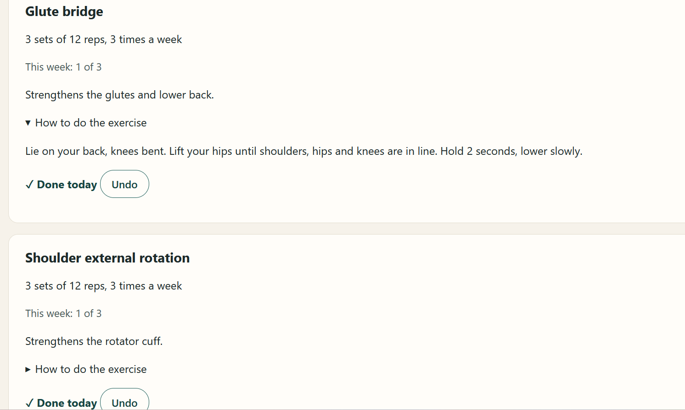

# D3 demo: My exercises on the website

Screenshots of the live website on 2026-11-19, logged in as a demo patient. All data is
fictional.

| # | Screenshot | What it shows | Requirement |
|---|---|---|---|
| 1 |  | The program given by the physiotherapist, with its dates and the share of sessions done. Each exercise shows its dose (sets, reps, times a week), this week's count, a description and how to do it. Checked off today, with **Undo** for a mistake. | B-EXE-03 |
| 2 |  | The other exercises of the same program, all checked off today. Before checking off, the patient can give a pain level from 0 to 10 (or not say); the physiotherapist sees adherence and pain in the workspace. | B-EXE-03, B-EXE-04 |

## Rules shown (checked by the API)

- One check-off per exercise per day (Montréal time); a second one, for example from the
  phone, is refused with a clear message.
- Only today's check-off can be undone.
- The page is the same program as the mobile app's Exercises tab: a check-off on one appears
  on the other.

## How to reproduce

1. Log in on the website as a demo patient who has a program.
2. Click **My exercises** (Mes exercices) in the menu.
