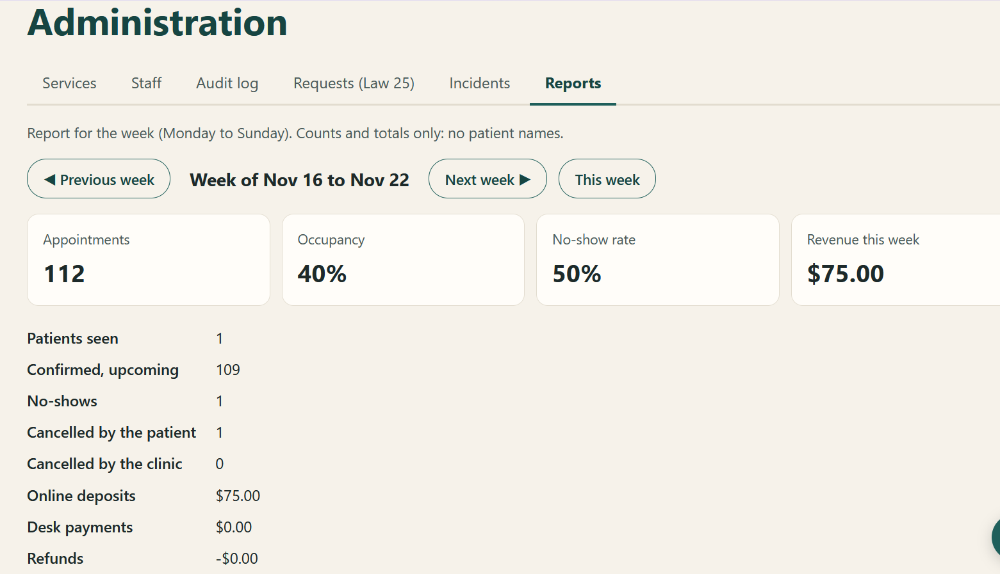
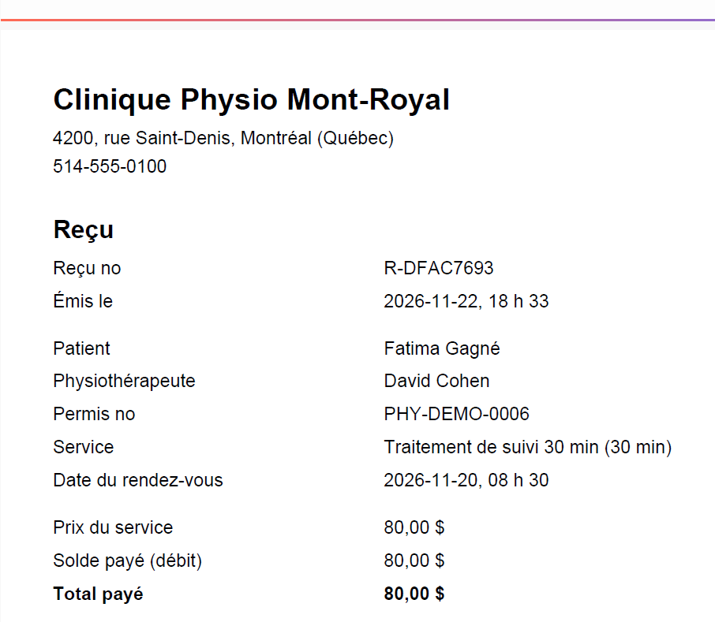

# D3 demo: weekly report, desk payment and receipt

Screenshots of the live system on 2026-11-22. All data is fictional.

| # | Screenshot | What it shows | Requirement |
|---|---|---|---|
| 1 |  | The administrator's **Reports** tab: appointments, occupancy, no-show rate and revenue for one week, with the detail of cancellations and payments. Counts and totals only, no patient names. Previous and next week buttons. | B-ADM-02 |
| 2 |  | The PDF receipt after the balance was paid by debit at the front desk (desktop app): clinic, physiotherapist and licence number, service, date and amounts. The amount was computed by the server. | B-FRD-05, B-BKG-10 |

## How to reproduce

1. Desktop app (front desk): check in a patient (**Arrivé**), choose **Débit**, click **Encaisser** and confirm, then **Reçu**.
2. Website (patient): **Mes rendez-vous → Mes reçus → Télécharger le reçu (PDF)**.
3. Website (administrator): **Administration → Rapports**.
