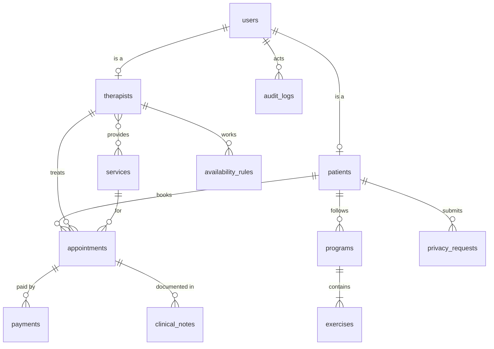
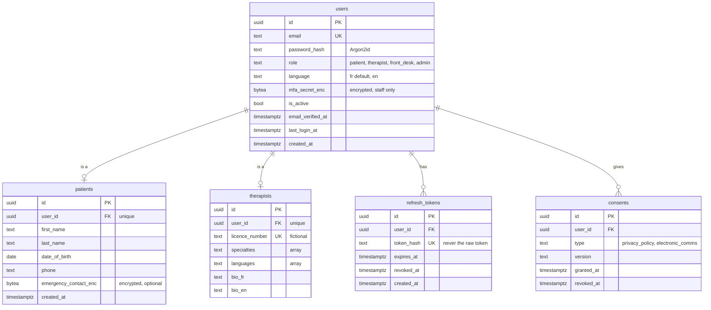
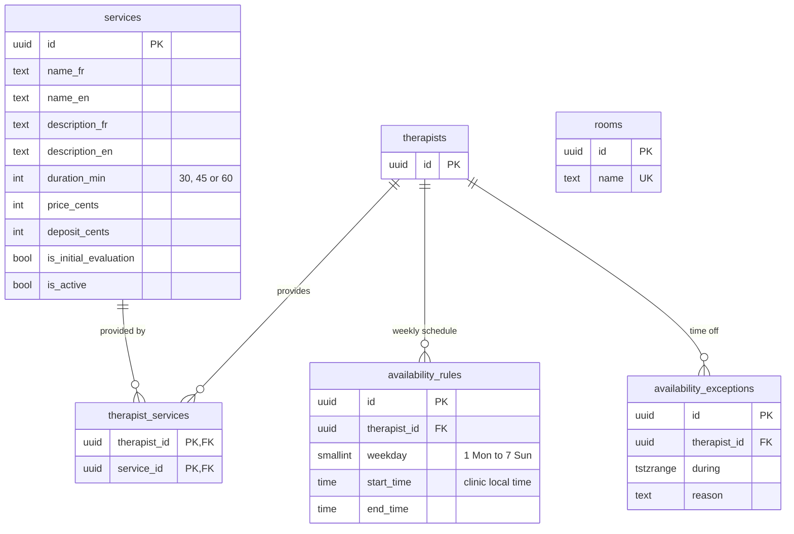
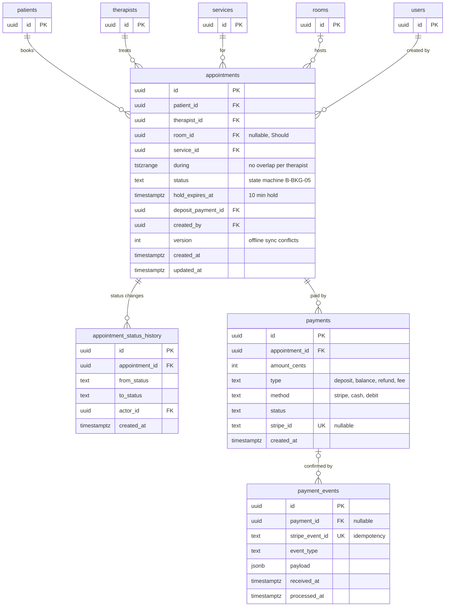
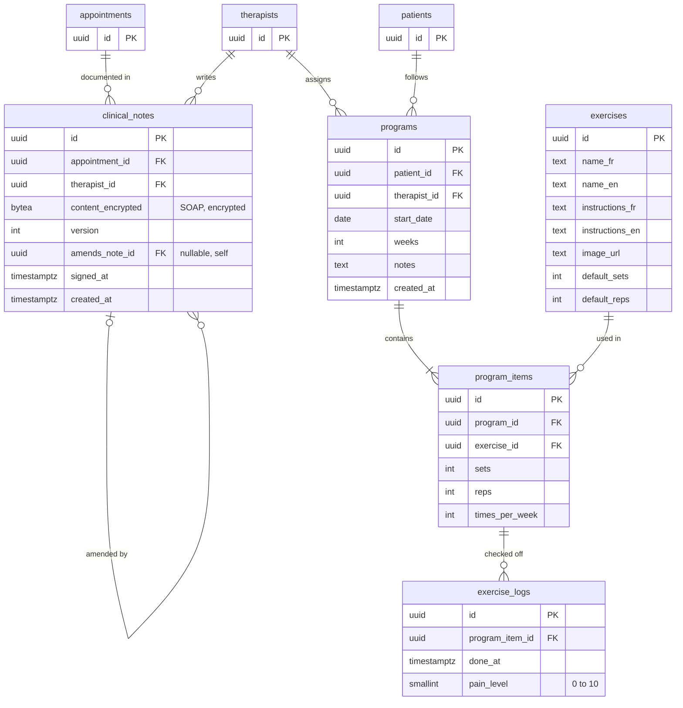
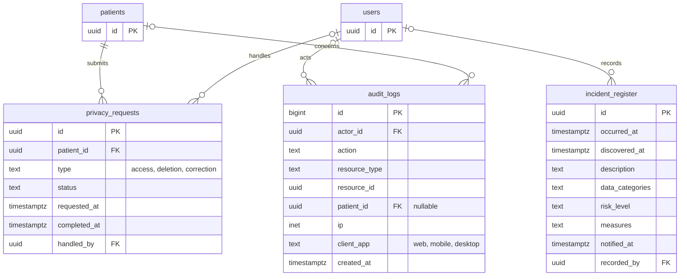
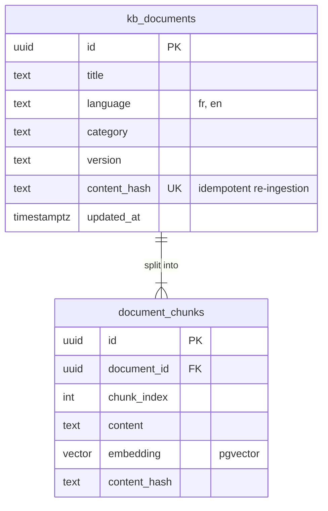

# Entity-Relationship Diagram — Clinique Physio Mont-Royal

Source: cahier des charges, section B.6 (data model), plus the requirements in B.4.  
Status: **draft for D1** (v0.1.0).

The model is split into an overview and six modules so each diagram stays readable. In the module diagrams, tables from other modules appear with their `id` only.

## How to read the diagrams

| Symbol | Meaning |
|---|---|
| `PK` | Primary key |
| `FK` | Foreign key (points to another table) |
| `UK` | Unique |
| `\|\|--o{` | One to many (zero or more) |
| `\|\|--\|{` | One to many (at least one) |
| `\|\|--o\|` | One to zero or one |
| `\|o--o{` | Optional link: zero or one to many |

## Overview

The main tables and how they connect, without columns.

## 1. Identity and access

Who can log in, with which role, and what they consented to (B-AUTH, Law 25).

- A user has exactly one role. A patient or therapist row adds the role-specific details.
- `refresh_tokens` stores only a hash of each token, so a stolen database can't be used to log in.
- `consents` keeps the version and date of each consent (B-AUTH-01).

## 2. Services and availability

What the clinic offers and when each therapist works (B-AVL).

- `therapist_services` is the many-to-many link: which therapist can provide which service.
- Bookable slots are not stored. They are computed: availability rules, minus exceptions, minus existing appointments (B-AVL-03).
- Rules use local `time`, so Monday 8:00 stays 8:00 clinic time across DST changes.
- `rooms` is a Should requirement (B-AVL-04).

## 3. Booking and payments

The transactional core: appointments, their status changes and their payments (B-BKG).

- **No double booking:** an exclusion constraint stops two active appointments overlapping for the same therapist (B-BKG-02, challenge B-C1).
- Every status change is a row in `appointment_status_history`, with who made it (B-BKG-05).
- `payment_events.stripe_event_id` is unique, so a webhook received twice is processed once (B-BKG-04).
- `version` lets the desktop app detect conflicts when it syncs offline actions (B-FRD-06).

## 4. Clinical file and exercises

The therapist's notes and the patient's exercise program (B-CLN, B-EXE).

- Note content is encrypted by the application before it reaches the database (B-CLN-02).
- Notes are never deleted. A correction is a new note pointing to the original with `amends_note_id` (BR-B-07).
- A program is a list of exercises; each check-off by the patient is one `exercise_logs` row, with an optional pain level.

## 5. Privacy, compliance and audit

Law 25 obligations and the audit trail (B-ADM, B-CLN-04).

- `audit_logs` is append-only: the application can insert and read rows but never change or delete them.
- `incident_register` is the confidentiality incident register Law 25 requires (B-ADM-05).

## 6. Chatbot knowledge base

Documents the chatbot answers from (spec section 8).

- Each document is split into chunks, and each chunk has an embedding vector used for similarity search.
- These tables never contain patient information.
- Conversation tables (`chat_*`) are added in D2.

## Design notes

1. **UUID primary keys.** IDs can't be guessed, which reduces IDOR risk (challenge B-C3). Ownership is still checked on every request; UUIDs are only a second layer. `audit_logs` uses `bigint` because it's never exposed by ID.
2. **Money in cents** (`int`), never floating point.
3. **All timestamps are `timestamptz`**, stored in UTC and displayed in `America/Toronto` (B-BKG-07).
4. **No double booking (B-BKG-02)**, using the `btree_gist` extension:
   `EXCLUDE USING gist (therapist_id WITH =, during WITH &&) WHERE (status IN ('held','pending_payment','confirmed','checked_in'))`.
   The same constraint applies to `room_id` if rooms are implemented.
5. **Clinical notes are never deleted.** The application's database role has no `DELETE` permission on `clinical_notes`.
6. **Encrypted fields** (`*_enc`, `content_encrypted`) are `bytea`, encrypted in the application with a key kept outside the database.

## Additions to the spec's model

These are not in B.6, but the requirements need them:

| Addition | Why |
|---|---|
| `refresh_tokens` table | Store a hash of each refresh token so it can be revoked at logout or if stolen (B-AUTH-02). |
| `users.email_verified_at` | Email verification at registration (B-AUTH-01). |
| `appointments.hold_expires_at` | The 10-minute hold during payment (B-BKG-03). |
| `appointments.version` and `updated_at` | Detect conflicts when the desktop app syncs offline actions (B-FRD-06). |
| `payments.status` | Track pending, succeeded, failed and refunded payments. |
