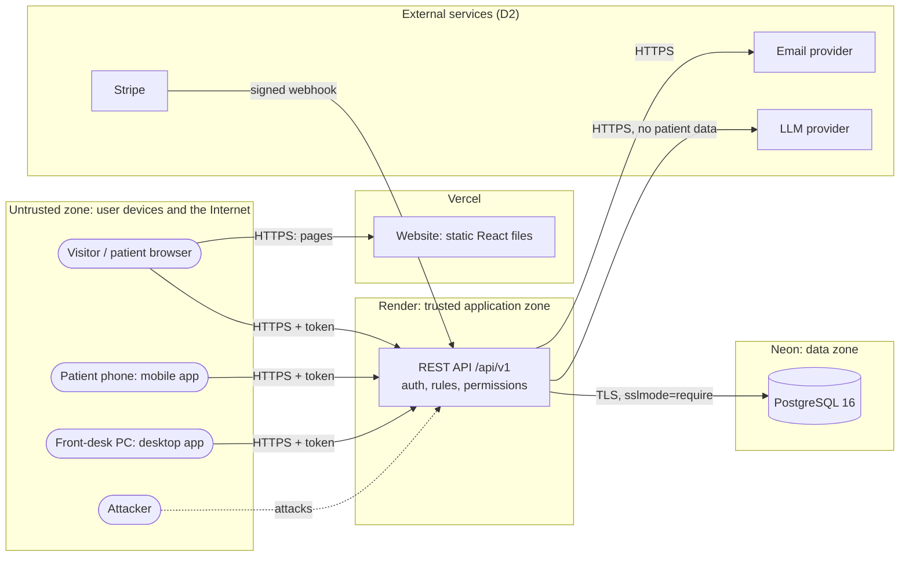

# Threat model — Clinique Physio Mont-Royal

Status: **D1 (v0.1.0)**, to be updated at D2 and D3.
Method: STRIDE (Spoofing, Tampering, Repudiation, Information disclosure, Denial of service,
Elevation of privilege), applied to each main data flow.
Companion document: [data-classification.md](data-classification.md).

Every mitigation is marked:

- ✅ **Implemented**, with the automated test that proves it (in `api/tests/` unless stated).
- ⏳ **Planned**, with the deliverable where it is due (D2 or D3).

## 1. What we protect (assets)

| Asset | Why it matters |
|---|---|
| Clinical notes and exercise programs | Health information: the most sensitive category under Law 25. A leak harms patients and the clinic. |
| Patient identity and contact data | Name, date of birth, phone, email, emergency contact: personal information under Law 25. |
| Appointment schedule | Reveals who is a patient of the clinic and when. Its integrity is the clinic's business (no double booking). |
| Staff accounts (therapist, front desk, admin) | Give access to many patients at once: the highest-value target for an attacker. |
| Secrets (JWT secret, encryption key, database password) | Whoever has them can forge sessions or read encrypted data. |
| Payments (D2) | Deposits and refunds through Stripe; card data never reaches our systems. |
| Audit trail (D2) | Proof of who accessed which patient file; must not be altered. |

## 2. Actors and trust

| Actor | Trust | Notes |
|---|---|---|
| Visitor (anonymous) | None | Can read public pages and free slots, register. |
| Patient | Low | Only their own data. |
| Physiotherapist | Medium | Only their own patients (care relationship), with MFA. |
| Front desk | Medium | All schedules, no clinical notes, with MFA. |
| Clinic administrator | High | Administration and compliance, no clinical notes by default, with MFA. |
| External attacker | Hostile | Anywhere on the Internet. |
| Malicious or curious insider | Hostile | A staff member or patient trying to see more than they should. |
| Stripe, email provider, LLM provider (D2) | Partly trusted | External services; their inputs are verified (e.g. signed webhooks). |

## 3. Data flows and trust boundaries

| # | Trust boundary | What crosses it | Main control |
|---|---|---|---|
| TB1 | User device → API | Every request from the three clients | TLS; token checked on every request; input validated by Pydantic schemas; rate limits |
| TB2 | API → database | SQL queries and results | TLS to Neon; parameterized queries (SQLAlchemy); credentials only in environment variables |
| TB3 | Browser → website | Static files | HTTPS; Content-Security-Policy and security headers (`web/vercel.json`) |
| TB4 | External services ↔ API (D2) | Webhooks, emails, chatbot prompts | Signature checks (Stripe); no clinical data in emails or prompts |
| TB5 | Developer → repository → hosting | Code and configuration | Pull requests with CI checks; secrets never in the repository |

## 4. STRIDE analysis

### 4.1 Authentication: login, MFA, session refresh

| ID | STRIDE | Threat | Mitigation | Req. | Status |
|---|---|---|---|---|---|
| T-AUTH-1 | S | Password guessing (brute force, credential stuffing) | Rate limit 5 login attempts per minute per IP; account locked 15 minutes after 5 failures; owner notified by email | B-AUTH-06, NFR-05 | ✅ `test_brute_force.py` |
| T-AUTH-2 | S | Stolen staff password used alone | Mandatory TOTP code for every staff role; staff endpoints refuse tokens without `mfa: true` | B-AUTH-04 | ✅ `test_mfa.py` |
| T-AUTH-3 | S | A 6-digit code is observed and replayed | Each TOTP time step can be used only once (`mfa_last_used_step`) | B-AUTH-04 | ✅ `test_a_code_cannot_be_used_twice` |
| T-AUTH-4 | I | Finding which emails have an account (user enumeration) | Same answer for "wrong password" and "unknown email", same timing (dummy hash); registration answers the same for new and existing emails; lockout answer identical to a wrong password | B-AUTH-03 | ✅ `test_wrong_password_and_unknown_email_get_the_same_answer`, `test_existing_email_gets_same_answer_and_no_second_account`, `test_locked_answer_looks_exactly_like_a_wrong_password` |
| T-AUTH-5 | I | Database leak reveals passwords | Argon2id hashing (memory-hard); passwords of at least 12 characters, not containing the email | NFR-02, B-AUTH-03 | ✅ `test_password_is_stored_as_argon2id_hash`, `test_weak_passwords_are_refused` |
| T-AUTH-6 | I | Database leak reveals MFA secrets | MFA secrets encrypted (Fernet: AES with HMAC) with a key kept outside the database | B-AUTH-04 | ✅ `test_first_login_enrolment_then_session_with_mfa` |
| T-AUTH-7 | S | Stolen access token reused | Access token lasts 10 minutes; signed (HS256), purpose-bound (an email or MFA ticket cannot be used as an access token) | B-AUTH-02 | ✅ `test_access_token_lasts_at_most_10_minutes`, `test_other_token_types_are_refused_as_access_token` |
| T-AUTH-8 | S | Stolen refresh token reused | Refresh token in an httpOnly cookie (not readable by JavaScript), only sent to `/api/v1/auth`; stored as a SHA-256 hash; rotated at each use; reuse of an old token cancels every session of the user | B-AUTH-02, B-C4 | ✅ `test_refresh_gives_new_tokens_and_old_refresh_token_stops_working`, `test_reusing_an_old_refresh_token_cancels_all_sessions` |
| T-AUTH-9 | S | Unattended staff workstation | Staff sessions expire after 15 minutes without activity (server-side refresh lifetime) | B-AUTH-02 | ✅ `test_staff_session_expires_after_15_minutes_of_inactivity` · ⏳ desktop auto-lock screen (D3) |
| T-AUTH-10 | E | A patient makes themself admin at registration | The role is never taken from the request; registration always creates a patient | B-AUTH-01 | ✅ `test_role_cannot_be_chosen_by_the_client` |
| T-AUTH-11 | E | A forged or modified token claims a higher role | Role read from the database on every request, not trusted from the token | B-AUTH-05 | ✅ `test_staff_endpoint_refuses_patients_even_with_mfa_claim` |
| T-AUTH-12 | S | MFA set up again by someone who only knows the password | Enrolment is refused once MFA is active | B-AUTH-04 | ✅ `test_enrolment_cannot_be_restarted_with_only_a_password` |
| T-AUTH-13 | T | Cross-site request (CSRF) on `/auth/refresh` or `/auth/logout` | Cookie limited to the auth path; CORS allows only the clinic's website, so another site cannot read the new token | NFR-03 | ✅ CORS test `test_cors_allows_the_web_app_and_refuses_other_sites` · ⏳ Origin header check on auth endpoints (D2), see residual risk R-4 |
| T-AUTH-15 | S | Account takeover through the password reset | Reset link is a 256-bit random value stored as a SHA-256 hash; single use; expires after 30 minutes; a new request cancels older links; all sessions cancelled after a reset; owner told by email; staff still need their MFA code; 5 requests per minute per IP | B-AUTH-03 | ✅ `test_password_reset.py` |
| T-AUTH-16 | I | Finding which emails have an account through "forgot password" | Same answer and status for known and unknown emails; the email is sent after the answer (background task), so response time reveals nothing | B-AUTH-03 | ✅ `test_same_answer_whether_or_not_the_account_exists` |
| T-AUTH-14 | R | A user denies having logged in | `last_login_at` recorded | B-CLN-04 | ✅ partial · ⏳ full audit log (D2) |

### 4.2 Booking and availability

| ID | STRIDE | Threat | Mitigation | Req. | Status |
|---|---|---|---|---|---|
| T-BKG-1 | T | Two patients book the same slot at the same moment (race condition) | PostgreSQL exclusion constraint on (therapist, time range) for active statuses: the database refuses the second booking; competing bookings for one therapist take turns (transaction lock) so losers get a clear refusal, not a deadlock (ADR-001) | B-BKG-02, B-C1 | ✅ `test_30_concurrent_bookings_only_one_succeeds`, `test_the_database_alone_never_accepts_two_bookings`, `test_race_lost_at_the_database_gives_409` |
| T-BKG-2 | T | Wrong times around daylight saving changes (booking at the wrong hour, wrong 24 h cancellation rule) | Times stored in UTC (`timestamptz`); schedules defined in clinic local time and converted per date | B-BKG-07, B-C2 | ✅ `test_slots.py` (November and March changes) · ✅ `test_24_hours_are_real_hours_across_the_november_change` |
| T-BKG-3 | D | Requests for huge date ranges overload the API | Searches limited to 31 days, at most 60 days ahead; lists limited (e.g. 50 appointments) | NFR-07 | ✅ `test_invalid_ranges_are_refused`, `test_no_slots_more_than_60_days_ahead` |
| T-BKG-4 | E | A therapist deletes another therapist's time off (IDOR) | Ownership checked in the database query; unknown or foreign id answers 404, revealing nothing | B-C3 | ✅ `test_therapist_cannot_delete_another_therapists_time_off` |
| T-BKG-5 | S/T | Slots held forever to block the schedule | 10-minute hold, then status `expired`; a new hold replaces the patient's unpaid one (one slot at a time); 20 booking requests per minute per IP | B-BKG-03 | ✅ `test_expired_hold_does_not_block_but_active_hold_does`, `test_an_expired_hold_frees_the_slot`, `test_a_new_hold_replaces_the_patients_previous_hold` |
| T-BKG-6 | T/R | Fake payment confirmation; webhook replayed | Stripe signature verified; each Stripe event processed once (unique `stripe_event_id`) | B-BKG-04 | ⏳ D2 |
| T-BKG-8 | E | A patient cancels or moves another patient's appointment (IDOR) | Every change looks the appointment up by id **and** the logged-in patient; otherwise 404, revealing nothing | B-C3 | ✅ `test_patients_cannot_cancel_someone_elses_appointment`, `test_patients_cannot_reschedule_someone_elses_appointment` |
| T-BKG-7 | R | Who changed an appointment's status is unknown | Status history table with the actor and a reason; rows only added | B-BKG-05 | ✅ `test_booking.py` (history checked on hold, cancel, reschedule, expiry) |

### 4.3 Patient data and clinical file

| ID | STRIDE | Threat | Mitigation | Req. | Status |
|---|---|---|---|---|---|
| T-CLN-1 | I/E | A patient reads another patient's appointments by changing an id (IDOR) | Patient endpoints never take a patient id: the query is always filtered by the logged-in patient | B-C3 | ✅ `test_patient_never_sees_another_patients_appointments` |
| T-CLN-2 | I | Front desk sees clinical information | Front-desk schedule returns only name, phone, service and status | B-CLN-05 | ✅ `test_schedule_contains_no_clinical_or_account_data` · ✅ `test_front_desk_and_admin_never_reach_clinical_notes` |
| T-CLN-3 | I | A therapist reads notes of patients they do not treat | Care relationship check: at least one confirmed, checked-in or completed appointment with that therapist; otherwise 404 (same as unknown) and the attempt is audited | B-AUTH-05, B-C3 | ✅ `test_therapist_without_care_relationship_cannot_read_a_note`, `test_cancelled_or_expired_appointments_give_no_access` |
| T-CLN-4 | I | Database leak exposes clinical notes or emergency contacts | Field-level encryption with a key outside the database | B-CLN-02 | ✅ emergency contact (`test_emergency_contact_is_encrypted`) · ✅ notes (`test_note_content_is_encrypted_in_the_database`) |
| T-CLN-5 | T/R | A note is changed or deleted after the fact | Notes locked after signature and never deleted, enforced by a database trigger (not only the API); corrections are signed amendments that keep the original | B-CLN-03, BR-B-07 | ✅ `test_database_refuses_changing_a_signed_note_or_deleting_any_note`, `test_amendment_keeps_the_original` |
| T-CLN-6 | R | Access to a file cannot be traced | Audit log of every read, write, signature and refused attempt, written in the same transaction as the action; a database trigger refuses any change or deletion of audit rows | B-CLN-04 | ✅ `test_database_refuses_changing_or_deleting_audit_entries`, `test_listing_a_patients_notes_audits_each_note` |
| T-CLN-7 | I | Personal data in logs, emails or notifications | Email addresses masked in logs (`c***@example.com`); reminders contain no clinical data | B-C7, BR-B-08 | ✅ masking in `app/services/email.py` · ⏳ log tests and reminders (D3) |

### 4.4 Client applications

| ID | STRIDE | Threat | Mitigation | Req. | Status |
|---|---|---|---|---|---|
| T-CLI-1 | I/E | Cross-site scripting (XSS) on the website steals a session | React escapes text; strict Content-Security-Policy (`script-src 'self'`); refresh token not readable by JavaScript | B-C4, NFR-03 | ✅ `web/src/pages/pages.test.jsx` (API text shown as text, not run) · CSP in `web/vercel.json` |
| T-CLI-2 | I | Clickjacking (site shown inside another site) | `X-Frame-Options: DENY`, `frame-ancestors 'none'` | NFR-03 | ✅ `test_security_headers_on_every_response` |
| T-CLI-3 | I | Token stolen from a lost phone | Token in the phone's secure storage (Keychain / Keystore), 10-minute lifetime | B.8.2 | ✅ `mobile/src/tokenStore.ts` |
| T-CLI-4 | I | Token stolen from the front-desk PC | Desktop token kept in memory only, never written to disk | B.8.3 | ✅ `desktop/.../Session.cs` · ⏳ encrypted offline cache (D3, B-FRD-06) |
| T-CLI-5 | I | Traffic intercepted on public Wi-Fi | HTTPS only; HSTS on the API and website | NFR-03 | ✅ `test_security_headers_on_every_response` (HSTS in production) |
| T-CLI-6 | E | Another website calls the API with the user's browser | CORS limited to the clinic's website | NFR-03 | ✅ `test_cors_allows_the_web_app_and_refuses_other_sites` |

### 4.5 Infrastructure, code and supply chain

| ID | STRIDE | Threat | Mitigation | Req. | Status |
|---|---|---|---|---|---|
| T-INF-1 | I | Secrets committed to the repository | `.env` ignored by Git; `.env.example` holds only placeholders; production secrets in the host's settings | NFR-02 | ✅ `.gitignore` · ⏳ GitHub secret scanning (needs repository admin) |
| T-INF-2 | T | SQL injection | All queries through SQLAlchemy with bound parameters; no SQL built from strings | OWASP A03 | ✅ Bandit in `api-ci` |
| T-INF-3 | T | Vulnerable dependency | pip-audit and npm audit in CI; Dependabot weekly | OWASP A06 | ✅ `api-ci`, `web-ci`, `.github/dependabot.yml` · ⏳ CodeQL (needs repository admin or a public repository) |
| T-INF-4 | T | Unreviewed code reaches production | Pull requests with green CI before merge | spec 7.1 | ✅ practice · ⏳ branch protection enforced (needs repository admin) |
| T-INF-5 | D | API flooded with requests | Rate limits on authentication endpoints; host platform limits | NFR-05 | ✅ partial (see R-3) |
| T-INF-6 | I | Detailed errors reveal internals | Generic error messages to clients; validation errors without stack traces | OWASP A05 | ✅ |

## 5. Residual and accepted risks

| ID | Risk | Why accepted (for now) | Plan |
|---|---|---|---|
| R-1 | `zod` (build tooling of Expo SDK 58) has a known "high" advisory | Only validates our own configuration at build time; not shipped in the app; fixing requires a newer Expo release | Update Expo when the fix ships |
| R-2 | Demo hosting (Render, Neon) is in the United States, not Québec | All data is fictional; a real deployment would need a Law 25 assessment for transfers outside Québec | Documented; out of scope for the student project |
| R-3 | Rate-limit counters are kept in the API's memory: they reset on restart and are not shared between instances | One instance on the free plan; lockout (stored in the database) still protects each account | Shared store (e.g. Redis) if the API ever runs on several instances |
| R-4 | Refresh cookie is `SameSite=None` in production because the website and the API are on different sites | Cookie is httpOnly, Secure, limited to `/api/v1/auth`; CORS stops other sites from reading tokens; worst case of a forged request is an unwanted logout or token rotation | Check the `Origin` header on auth endpoints (D2), or serve the API under the website's domain |
| R-5 | Branch protection, CodeQL and secret scanning are not enabled | They need repository admin rights or a public repository | Requested from the repository owner |
| R-6 | The free API host sleeps after inactivity (first request can take about a minute) | Availability, not confidentiality; acceptable for a demo | Paid plan for a real deployment |
| R-7 | Single signing key (HS256) shared by all tokens | Simple and safe while only the API issues and verifies tokens | Key rotation procedure in the D3 runbook |
| R-8 | .NET 8 reaches end of support in November 2026; ESLint 9 is deprecated | No known vulnerability; the spec requires .NET 8; ESLint 10 not yet supported by the React plugins | Upgrade when allowed and supported |
| R-9 | No email provider is connected yet: in production, confirmation and password reset emails are only logged (with a masked address), not delivered | Demo accounts are already confirmed; the flows are proven by automated tests and shown locally, where the email is printed in the API console | Connect a transactional email provider (planned with reminders, B-BKG-08) |

## 6. Review

This model is reviewed at each deliverable: new flows (booking with payment, clinical notes,
chatbot, offline desktop mode) are added at D2 and D3, and every ⏳ line must become ✅ or be
moved to the residual risks with a reason.
