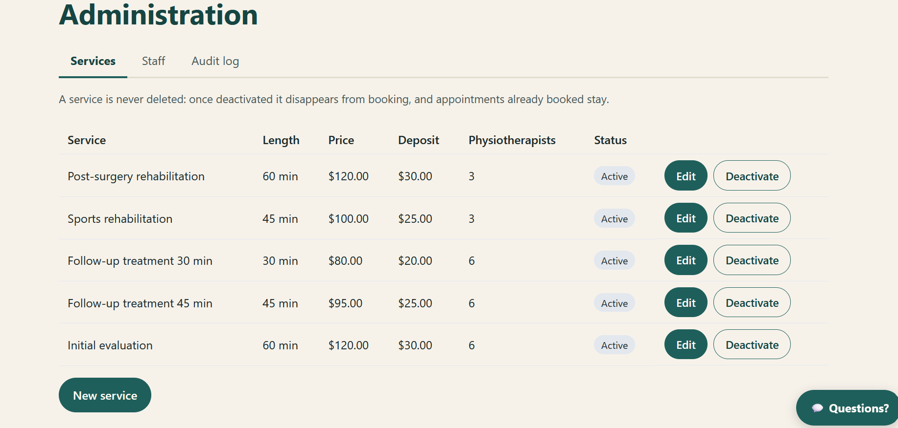
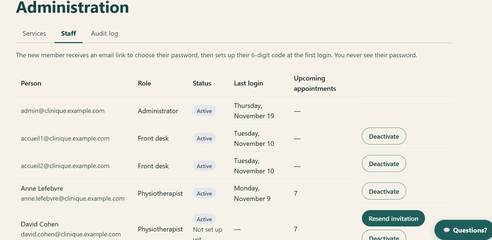
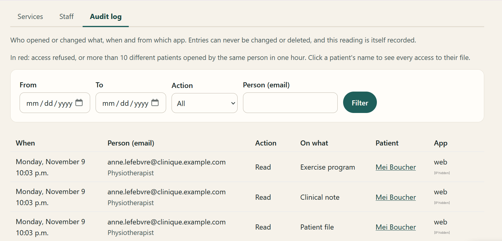
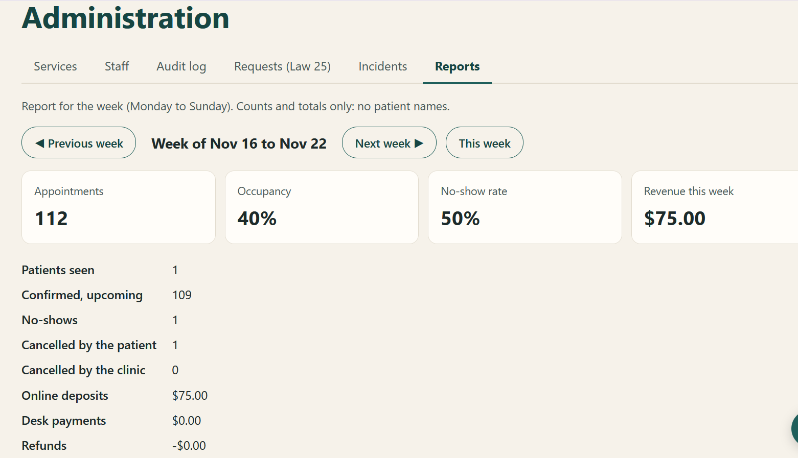
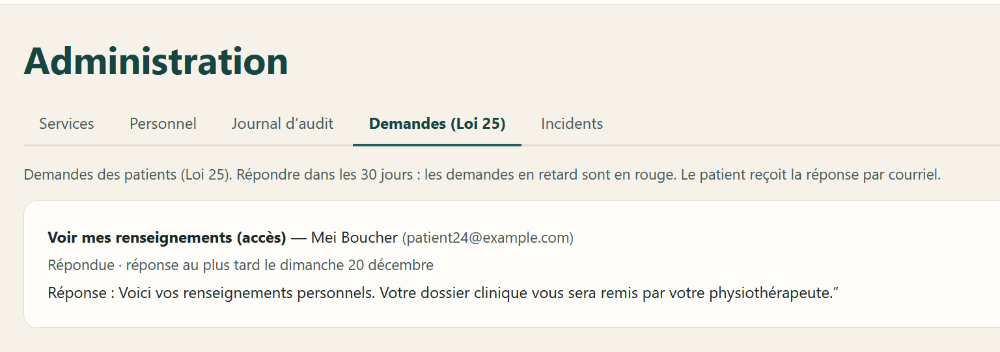
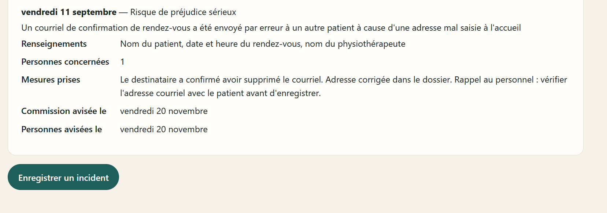

# Administrator guide (website)

Log in with your email, password and 6-digit code, then open **Administration**. The
administrator never sees clinical notes.

## 1. Services and prices

Tab **Services**: create a service (French and English names, duration, price, deposit),
change it with **Modifier**, or **Désactiver** it so it can no longer be booked (past
appointments keep it).

## 2. Staff

Tab **Personnel**: invite a new physiotherapist or front-desk agent (they receive a link to
choose a password and set up the 6-digit code), add a therapist's photo, or **Désactiver**
someone who leaves: their sessions end at once.

## 3. Audit log

Tab **Journal d'audit**: who opened or changed what, when and from which app. Filter by date,
action or email. Red lines: refused access, or more than 10 different patients opened by one
person in an hour. Click a patient's name to see every access to their file. Entries can never
be changed or deleted.

## 4. Weekly report

Tab **Rapports**: appointments, occupancy, no-show rate and revenue of a week, in total and per
physiotherapist. No patient names. Use **◀ Semaine précédente / Semaine suivante ▶** to move.

## 5. Privacy requests (Law 25)

Tab **Demandes (Loi 25)**: requests from patients (access, correction, deletion) with the
30-day deadline; late ones in red.

1. Open a request. For **access**, click **Préparer l'export (sans notes cliniques)**: a JSON
   file of the patient's information.
2. For **deletion**, confirm: the account is closed and the contact details erased; the health
   record is kept 5 years after the last visit, then anonymized.
3. Write the answer and mark the request as answered. The patient sees it in **Mes données**.

## 6. Confidentiality incidents

Tab **Incidents**: record any incident (what happened, data and people concerned, risk of
serious injury). If the risk is serious, notify the Commission d'accès à l'information and the
people concerned, then write the dates. Entries can be completed but never deleted.

