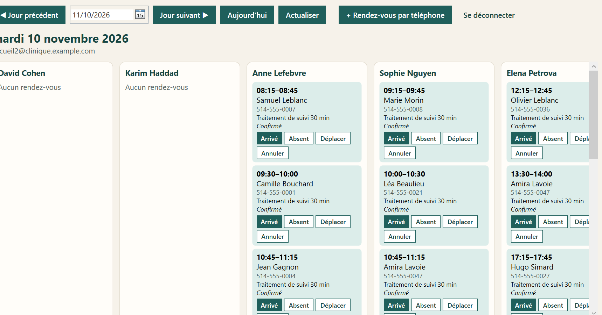
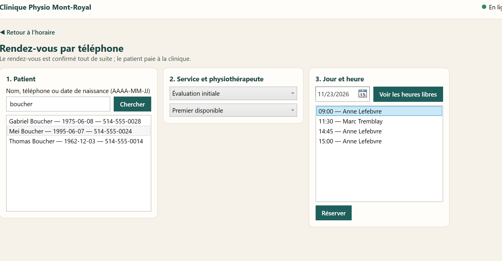
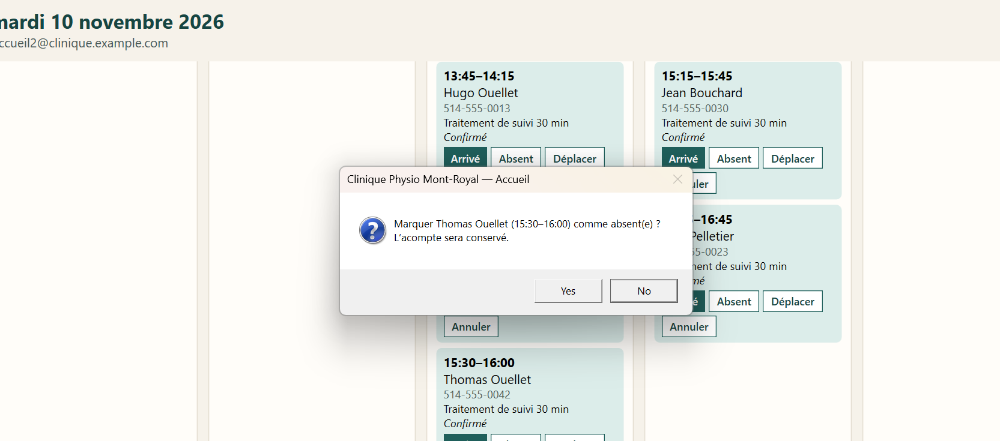

# Front desk guide (Windows app)

Install `CliniquePhysio-Accueil-Setup-1.0.0.exe` from the release page. Windows may show
"Windows protected your PC": click **More info → Run anyway**. Then open **Clinique Physio
Mont-Royal - Accueil** from the Start menu.

## 1. Log in

1. Enter your email and password, click **Se connecter**.
2. First time only: scan the QR code with Microsoft or Google Authenticator.
3. Enter the **6-digit code** shown in the authenticator app.

After 15 minutes without activity, or when the session expires, the app asks you to log in
again.

> Screenshot to add: `docs/user-guide/img/desk-login.png`

## 2. See the day

The day opens with **one column per physiotherapist**, in time order, with a coloured status.
Use **◀ Jour précédent / Jour suivant ▶**, the calendar, **Aujourd'hui** and **Actualiser**
to move between days.

## 3. Book for a patient on the phone

1. Click **+ Rendez-vous par téléphone**.
2. Search the patient by **name**, **phone** or **date of birth** (AAAA-MM-JJ), then click the
   right one (date of birth and phone tell namesakes apart).
3. Choose the service, a physiotherapist or **Premier disponible**, and the day.
4. Click a free time, then **Réserver**. The appointment is confirmed at once; the patient
   pays at the clinic.

## 4. When the patient arrives, or does not come

- **Arrivé**: the patient is here (only on the day of the appointment).
- **Absent**: 15 minutes after the start at the earliest; asks for confirmation; the deposit
  is kept.
- **Déplacer**: choose a new time for the patient.
- **Annuler**: the deposit is refunded only more than 24 hours before.

## 5. Take the payment and print a receipt

1. Choose how the patient pays in **Paiement à l'accueil** (debit, credit, cash).
2. On the card of a patient who has arrived, click **Encaisser**. The app shows the amount
   left to pay (computed by the server: price minus deposit) and asks to confirm.
3. Click **Reçu** to open the PDF receipt and print it.

## 6. If the internet connection drops

The day already on screen stays visible. **Arrivé** and **Absent** still work: the card shows
"En attente d'envoi (hors ligne)" and a banner counts the actions waiting. When the connection
returns, click **Envoyer maintenant** (or **Actualiser**).

If the appointment changed meanwhile (for example the patient cancelled online), your action
is **not** recorded and a **conflict** message explains why: check with the patient and book a
new time if needed. Booking, moving, cancelling and payments need the connection. Do not close
the app while actions are waiting (it asks first).

> Screenshot to add: `docs/user-guide/img/desk-offline.png`
