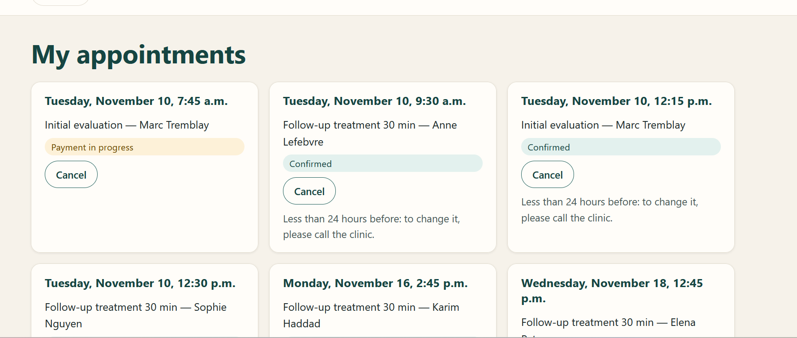
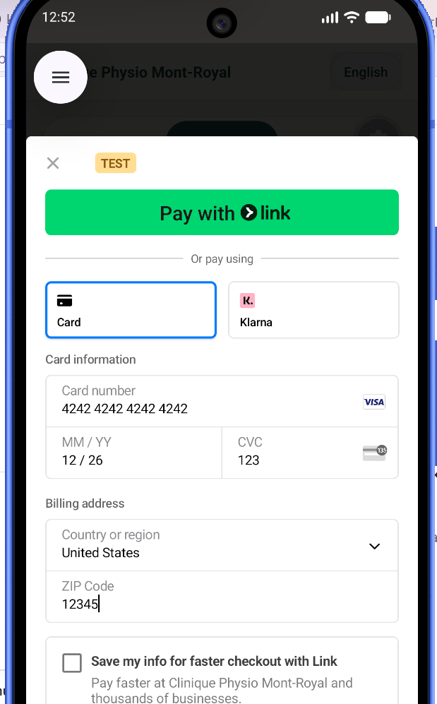
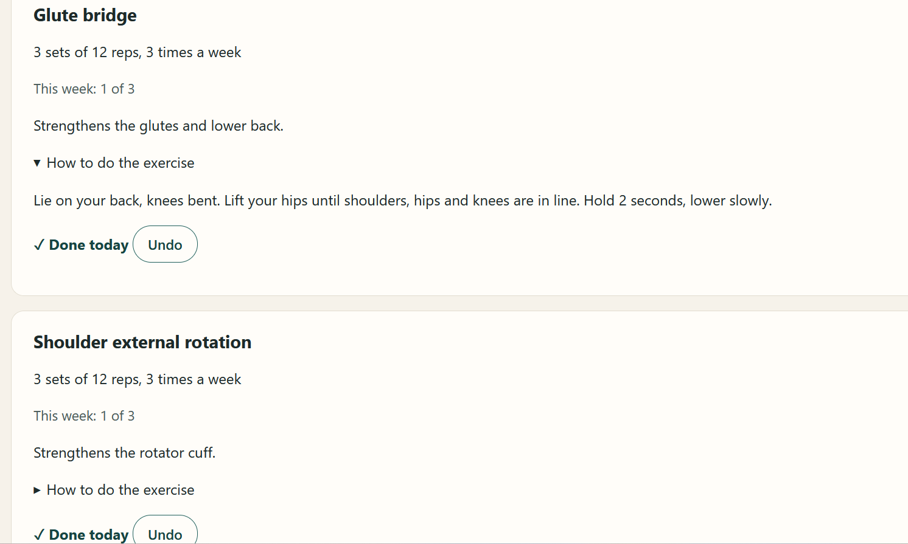
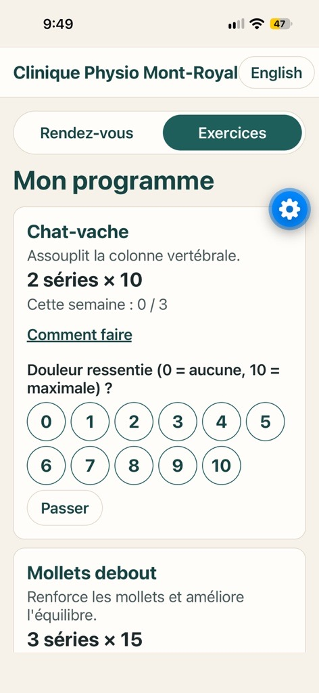
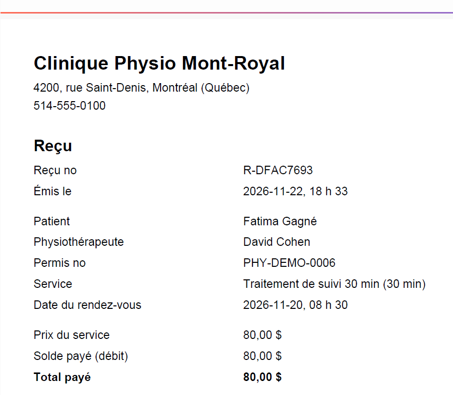
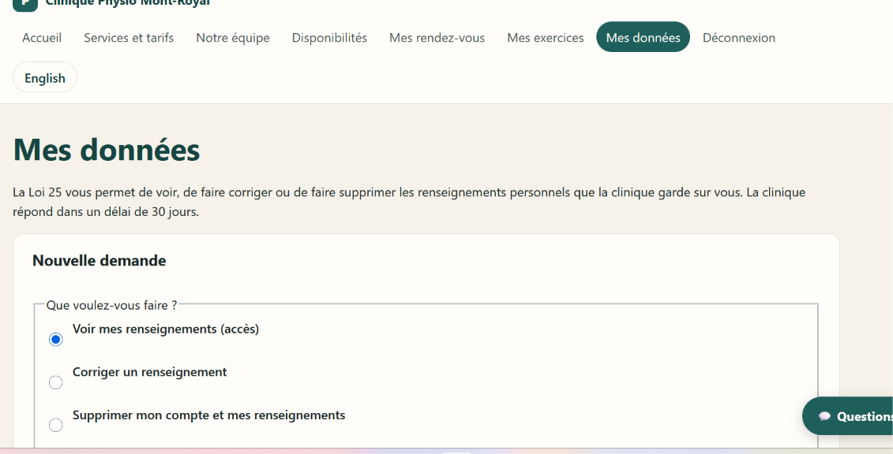
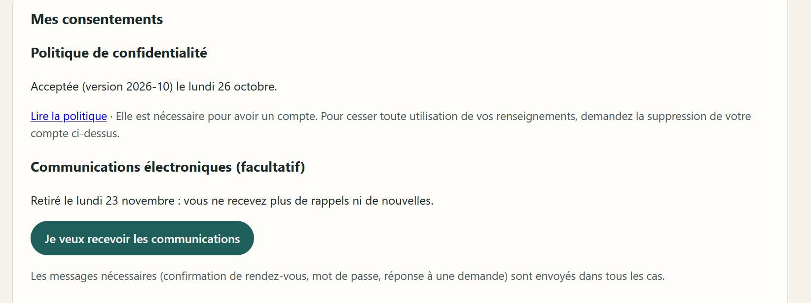
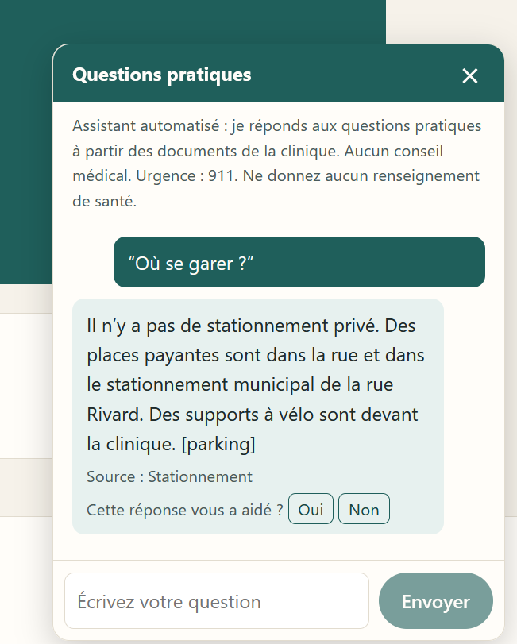

# Patient guide

Website: https://clinique-physio.vercel.app · Android app: `CliniquePhysio-1.0.0.apk` on the
release page.

## 1. Create an account

1. Click **Connexion → Créer un compte**.
2. Fill in your first and last name, date of birth, phone, email and a password (at least
   12 characters). The emergency contact is optional.
3. Tick **J'accepte la politique de confidentialité** (required; the link opens the policy).
   Ticking **communications électroniques** is optional.
4. Click **Créer mon compte**, then open the link received by email to confirm your address.

Online accounts are for people aged 14 or more; for a younger child, the parent calls the clinic.

> Screenshot to add: `docs/user-guide/img/patient-register.png`

## 2. Book an appointment

1. Click **Disponibilités**. Choose the **service**, a **physiotherapist** or **Premier
   disponible**, and the week.
2. Click a time. Log in if asked.
3. Check the summary and the rule: free cancellation more than 24 hours before (the deposit is
   refunded). Click **Réserver et payer le dépôt**.
4. The time is held for you for a few minutes. Pay the deposit with your card (test mode:
   `4242 4242 4242 4242`, any future date, any code). The rest is paid at the clinic.
5. The confirmation page appears and an email is prepared.

A first treatment needs an **initial evaluation** first; the site tells you if you choose a
follow-up too early.

**On the Android app:** tab **Réserver**, same choices, then Stripe's payment sheet:

## 3. Change or cancel

1. Open **Mes rendez-vous**.
2. **Changer l'heure**: choose a new time (more than 24 hours before the appointment).
3. **Annuler**: the message says whether the deposit will be refunded (more than 24 hours
   before) or kept (less than 24 hours). Confirm with **Oui, annuler**.
4. Less than 24 hours before, call the clinic at 514-555-0100.

## 4. Do my exercises

1. Open **Mes exercices** (website) or the **Exercices** tab (app). Your physiotherapist's
   program shows each exercise with its sets and repetitions.
2. After doing an exercise, tick it and give your **pain level** (0 to 10). Your
   physiotherapist sees your progress.

## 5. Get a receipt for my insurance

1. Open **Mes rendez-vous**, section **Mes reçus**.
2. Click **Télécharger le reçu (PDF)** next to a past visit. The receipt shows the clinic, the
   physiotherapist's licence number, the service, the date and every amount paid.

## 6. My personal information (Law 25)

1. Open **Mes données**.
2. **Mes consentements**: see the policy version you accepted; give or withdraw the optional
   consent to electronic messages at any time.
3. **Nouvelle demande**: ask to see your information, correct it, or delete your account.
   The clinic answers within 30 days, by email and on this page.

## 7. Ask a practical question

Click the chat button at the bottom right. The assistant answers questions about hours,
address, parking, prices, booking, cancellation and insurance from the clinic's documents. It
gives **no medical advice**; for an emergency it tells you to call **911** (or 811, 9-8-8).

