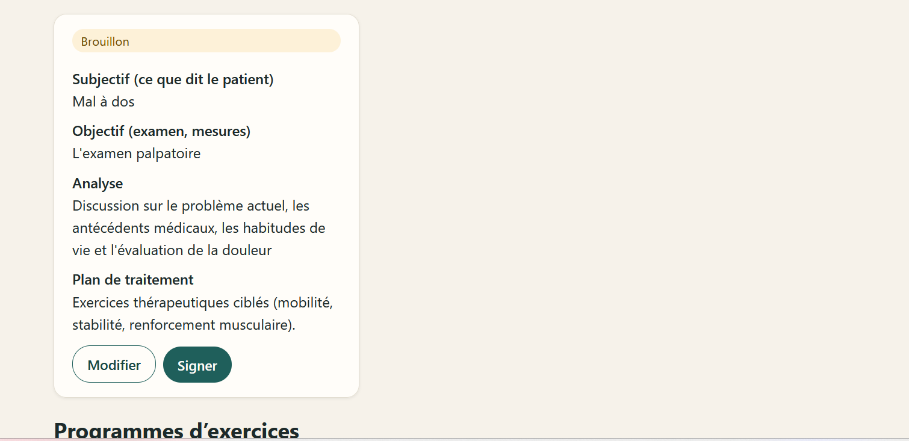
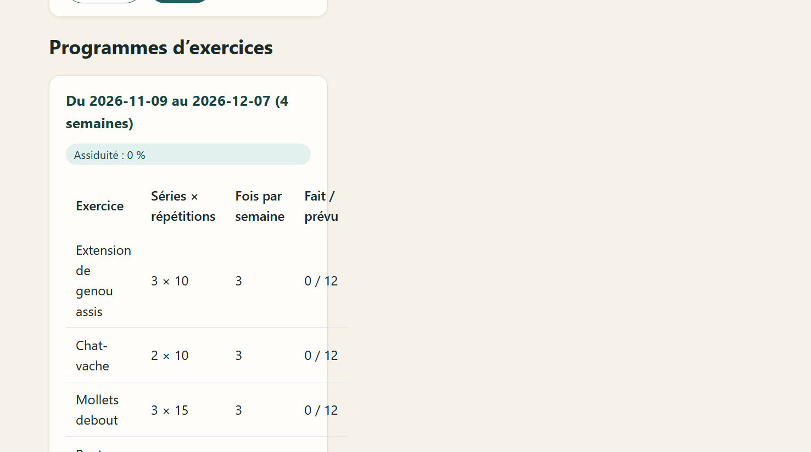
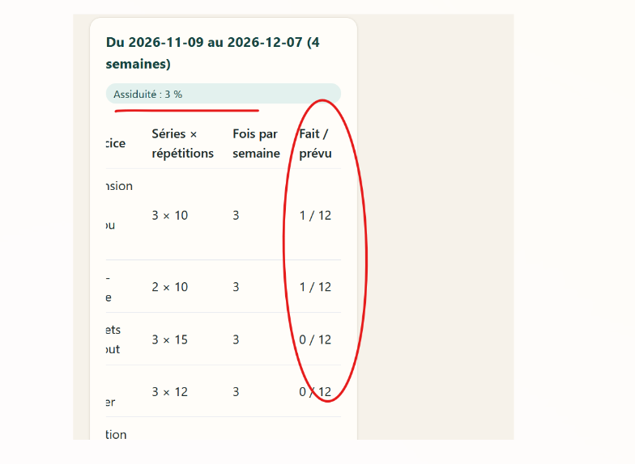

# Physiotherapist guide (website)

Log in on the website with your email, password and 6-digit code, then open **Espace
thérapeute**. You see **only the patients you treat**; every file you open is recorded in the
audit log.

## 1. Set my working hours and time off

1. In **Espace thérapeute**, click **Mes heures et congés**.
2. **Heures de travail de chaque semaine**: one line per working period (for example Monday
   08:00 to 12:00, then Monday 13:00 to 17:00). **Ajouter une plage** adds a line, **Retirer**
   removes one. Click **Enregistrer les heures**.
3. **Congés et absences**: choose the start and end (day and time), an optional reason without
   health information, then **Ajouter le congé**. Those hours disappear from the times offered
   to patients.

> Screenshot to add: `docs/user-guide/img/therapist-hours.png`

## 2. Open a patient file

1. In **Mes patients**, click the patient's name.
2. The file shows the contact details, the emergency contact, the appointments and the
   clinical notes.

## 3. Write and sign a SOAP note

1. Next to a past appointment, click **Rédiger la note**.
2. Fill in **S**ubjective, **O**bjective, **A**ssessment and **P**lan. **Enregistrer le
   brouillon** keeps a draft you can still change.
3. When it is final, click **Signer**, then **Signer définitivement**. A signed note can never
   be changed: to correct it, click **Ajouter un amendement** (also signed and dated).

Notes are encrypted in the database; the front desk and the administration can never read
them.

## 4. Give a home exercise program

1. In the patient file, section **Programmes d'exercices**, click **Nouveau programme**.
2. Choose the exercises from the library, with sets, repetitions and the number of weeks.
3. Click **Donner le programme**. The patient sees it on the website and in the app.
4. Later, the program shows the patient's **assiduité** (how often they did it) and their pain
   levels.

